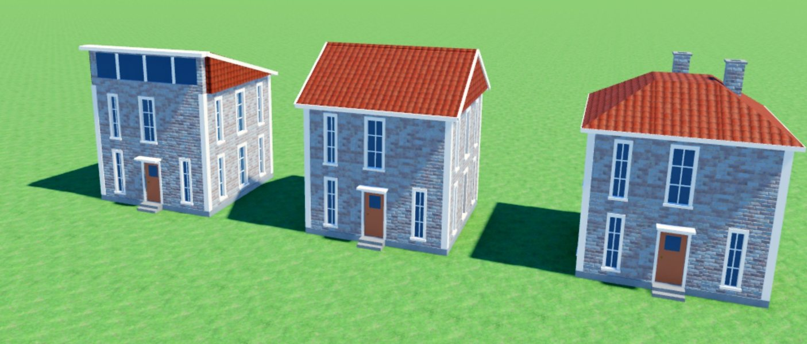
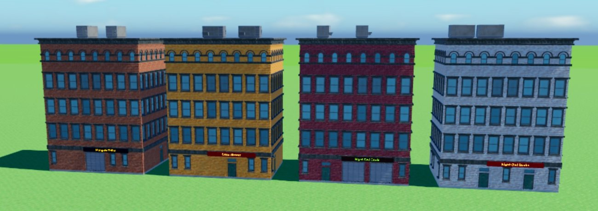

Two tools change a building after it is placed. The Building Designer changes the whole building. Inspect changes one cell at a time.

## Building Designer

Press **Building Designer** on the toolbar and select a placed building. The pencil on a catalog tile does both steps at once.

### Building settings

- **Piece set** picks the set of walls, windows and doors the building draws from.
- **Color theme** pins a theme. The swatches under it show the tones the building bakes with.
- **Roof** picks the set's own roof, **Gable** or **Shed**.
- **Stories**, **Seed**, **Slab color**, **Rooftop units** and the other rows each have an inline explainer.
- **Randomize** rolls a new seed and theme as one undo step.

*One house with **Roof** set to **Shed**, to **Gable**, and to the set's own roof.*

### Materials and colors

The designer lists the surfaces the building is made of, biggest first. Give each one a material and a color. You can pick Roblox's own materials or any MaterialVariant installed in the place. The choices survive re-bakes and travel with a style. **Reset all materials and colors** goes back to the set's look.

### Styles

What you change is saved as a style. The plugin's own entries never change, so your first edit saves a copy, and later edits go into that copy.

The **Style** section renames, copies and deletes styles. Turn off **Save my edits to the style** for a building that should change alone.

A style shows up in three places: on its entry's shelf in the City Builder dock, in the polygon building's **Style** list, and in the city bundle editor. Styles are stored in the place under `ServerStorage.CityBuilderStyles`.

### Your own pieces

1. Load a building and press **Create my piece set**. The plugin copies the building's pieces into the place.
2. Select a model or part in Studio and load it into a slot under **Model slots**.
3. Every building on that set re-bakes when its pieces change.

**Duplicate with a new seed** places a copy with a fresh seed, which is the fast way to grow a row of similar houses.

*One building with four seeds. The seed picks the theme, the shop sign and the ground floor.*

## Inspect

Pick the **Inspect** tile, or press **Inspect Buildings** on the toolbar, and press **Start inspecting**.

Hover a placed building and rest the mouse on a cell. A card opens that names the piece in that cell, and the highlight follows the wall. Change the piece from the card, for example a window for a door.

Buildings placed before cell editing existed need a refresh first. Load the building in the designer and press **Update building generator**.

## Generator code

**Generator code**, under Advanced settings, picks where buildings get the code that bakes them.

| Option | What it means |
| --- | --- |
| **In the plugin** | The default. No code is stored in the place. Without the plugin, buildings keep their geometry but stop re-baking. |
| **Copy in ServerStorage**, **Copy in ReplicatedStorage** | One shared `CityBuilderGenerators` folder. Buildings re-bake without the plugin and in a running game. |

**Move existing buildings** moves every building in the place onto the option you picked.

