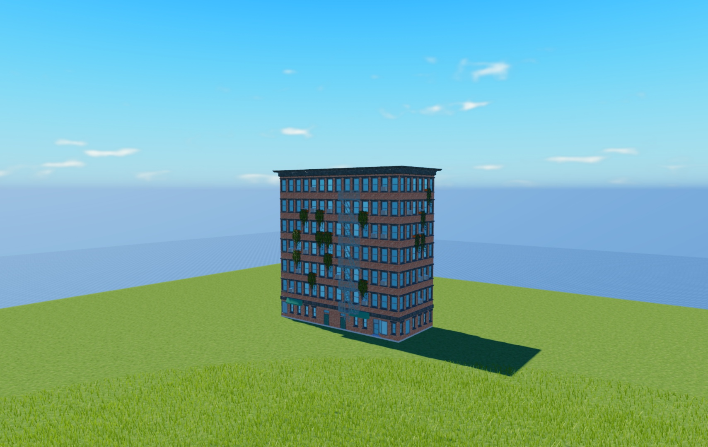

The **Buildings** tile holds the catalog. Buildings are grouped on shelves by what they are for, and the search box at the top finds one by name.

## Place a building

1. Pick the **Buildings** tile.
2. Click a building on a shelf. A ghost follows the mouse.
3. Click to place it. Keep clicking to place more.
4. Press **Stop placing**, or **Esc**.

Each ghost rolls its own color theme, so a street built from one entry does not come out in one color. What the ghost shows is what the click places.

## What is on the shelves

| Shelf | Examples |
| --- | --- |
| Residential | Brick apartment blocks, walk-up apartments, houses, cottages, villas, gardens. |
| Commercial | Shopfronts, corner stores, offices, mixed-use blocks. |
| Industrial | Warehouses, sheds, works with roof ducts and tanks. |
| Towers | Glass and stone towers with setbacks. |
| Skyscrapers | Art Deco, brutalist, cylindrical, tiered and more. |
| Modular sets | Buildings assembled from mesh pieces, including the polygon building and plants. |
| Civic buildings | Hospital, fire station, police headquarters, school, library, church, cathedral. |
| Power plants | Coal and solar. |
| Parks & transport | Park, parking lot, arch bridge. |
| Game stops | Gas station, garage, car wash, paint shop, pharmacy, hardware store, supermarket. |

What a building is for decides what hangs on its front. A residential building gets window air conditioners, planters, a fire escape and balconies. A commercial one gets a lettered sign over its shopfront. An industrial one gets mostly blank walls, ducts up its sides and more units on the roof.

## Resize

Select a building and use Studio's Scale tool.

- Drag one face and the building grows on that side only. Ctrl-drag grows it from the center.
- The footprint snaps to whole cells. A cell is normally 7.5 studs.
- The building lays itself out again at the new size: more window bays, more floors, a longer roof.

Civic buildings do the same. A larger parking lot gets more stalls, and a larger park gets more trees.

## Join buildings

Buildings of the tiled kind join when they overlap or touch. Stack one on a roof, or push a smaller extension against a side, and the covered walls are trimmed. Set a building's `JoinBuildings` attribute to false to keep it separate.

## Color themes

A building takes its wall colors from a theme: red brick, terracotta, sandstone, ochre, oxblood, moss, seafoam, powder blue, limestone, whitewash, slate or charcoal. The default, Random, lets the building's seed pick. Pin a theme in the [Building Designer](./building-designer.md).

## Your own styles

The pencil on a building's tile places one where the camera looks and opens it in the Building Designer. What you change there is saved as a style of your own, and the style shows up on the same shelf with a green name strip.
