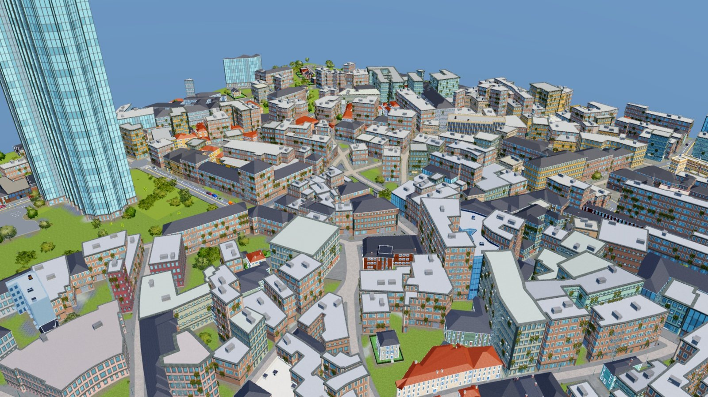
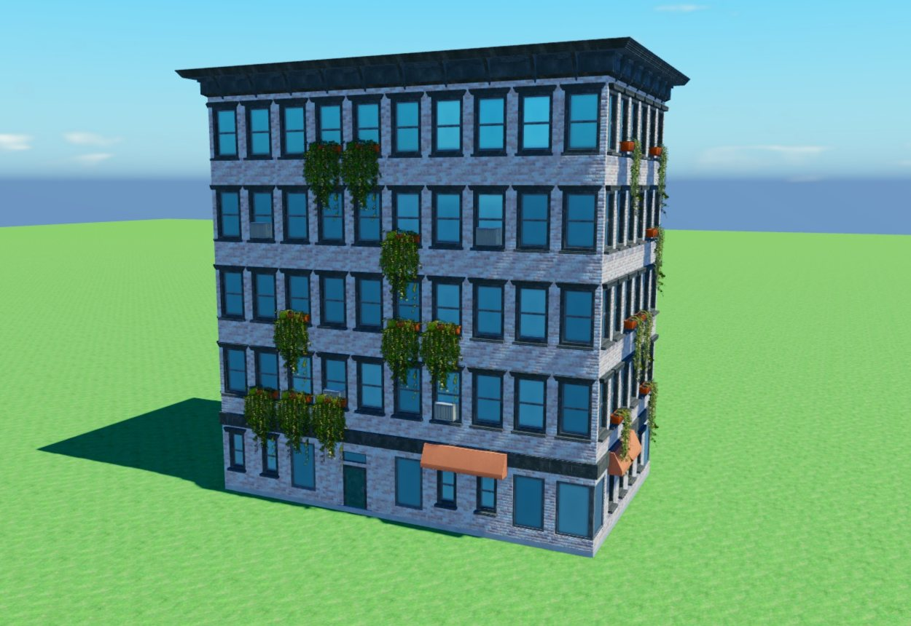
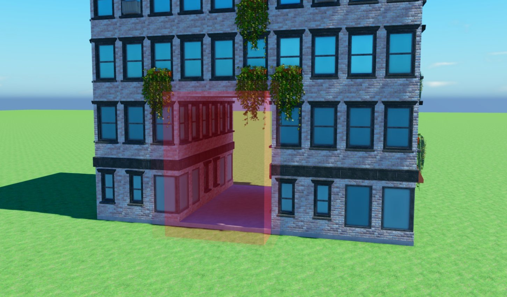
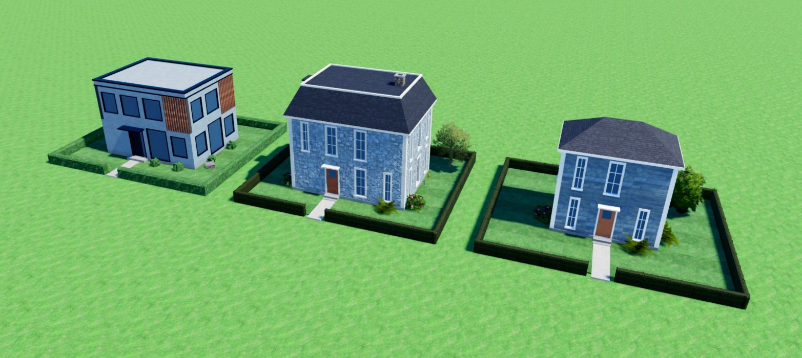

A polygon building stands on any outline you draw, convex or not. It borrows its walls, storey height and roof from one of the catalog's buildings.

*Polygon buildings on real outlines. The City Generator uses them for every mapped building.*

## Draw one

1. Pick the **Polygon building** tile.
2. Pick a **Style** and set **Stories**.
3. Press **Start drawing polygon buildings**.
4. Click the corners on the ground.
5. Click the first corner again, or press **Enter** or **Space**, to build it.

**Backspace** takes back a corner. **Esc** clears the outline. The longest side gets the door.

The **Style** list also holds parks, parking lots and gardens. Those fill the outline instead of standing a building on it. A parking lot drawn beside a road gets a driveway onto it.

## Reshape one

Select a placed polygon building. Discs appear on its corners and on the middle of each side.

- Drag a corner disc to move that corner.
- Drag a side's middle disc to add a corner there.
- Select a corner disc and press **Delete** to remove that corner.

When the handle settles the building re-bakes as one undo step. An outline that crosses itself is refused. Studio's Scale tool stretches the whole outline.

## How it is built

Each side gets a run of wall pieces, stretched a little along the wall so whole pieces close it. Corners close to square get the style's corner pieces, and other corners get a seam column. The building uses the style's wide and multi-storey windows, balconies, window addons and fire escapes.

## Holes

A **Hole** model subtracts its box from the buildings it touches. Place one on a building, or move one into it, and the building re-bakes with the opening.

| Before | With a Hole model |
| :-: | :-: |
|  |  |

*The red box is the Hole model. The building re-bakes around it and lines the passage with walls.*

What the building does depends on where the box stands.

- **A hole through an outside wall, above the ground floor.** The storeys it crosses stand on a smaller outline. They get new walls along the cut from the same style, with corner pieces where the cut turns. The storey under the cut keeps its cap row along the edge and gets a roof terrace. A hole through the top storey takes the roof with it, so the roof follows the smaller outline. Cut a corner off the top floors and the building steps down there.
- **A balcony-sized hole in a wall.** This works the same way. The hole's back wall gets wall pieces, the storey below gives it a ledge and a low parapet, and the storey above gets a slab over it.
- **A passage or tunnel.** A hole across the ground floor, or one inside the outline, leaves out the cells it covers. A hole that reaches deep inside is lined with walls and a ceiling.
- On a facade building, the walls step back around the hole the same way, with facade on its sides. On a graybox building the opening is cut exactly where the box stands.
- Move, resize or delete the hole and the building closes up or opens to match.

The sides of a hole move to the nearest joint between wall pieces, at most half a piece, so the new walls line up with the storeys under them. Some styles use windows three storeys tall for their middle floors, Brick Shopfront among them. If a hole cuts through only one or two storeys, those windows don't fit, so the new walls get the style's plain one-storey pieces.

Use a hole for a gateway to a courtyard or a street-level passage. Generated cities do this themselves: where a block's buildings close in its courtyard, one or two of them get a passage named Tunnel.

## Gardens and parks

The **Garden** entry is a model that goes around a house: a lawn, a hedge around the parcel, a path from the front door, and plants along the walls. Hover a house while placing a garden and the ghost fits itself to the house. Selecting a placed garden shows corner handles on the ground for reshaping it, the same way a polygon building does.

**Low Poly Garden** lays out the same lot from a few dozen plain parts.
