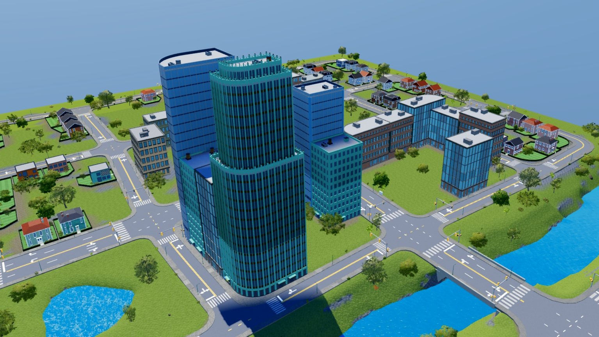
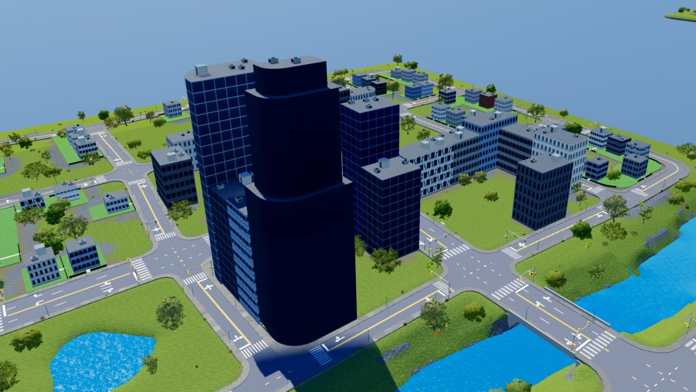
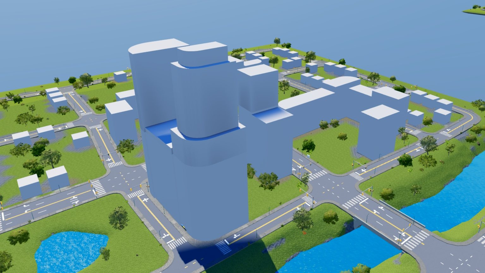
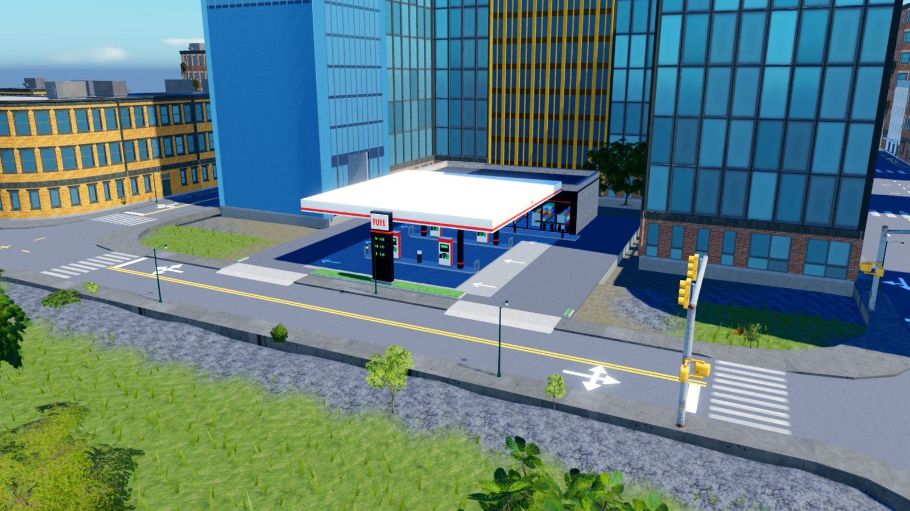
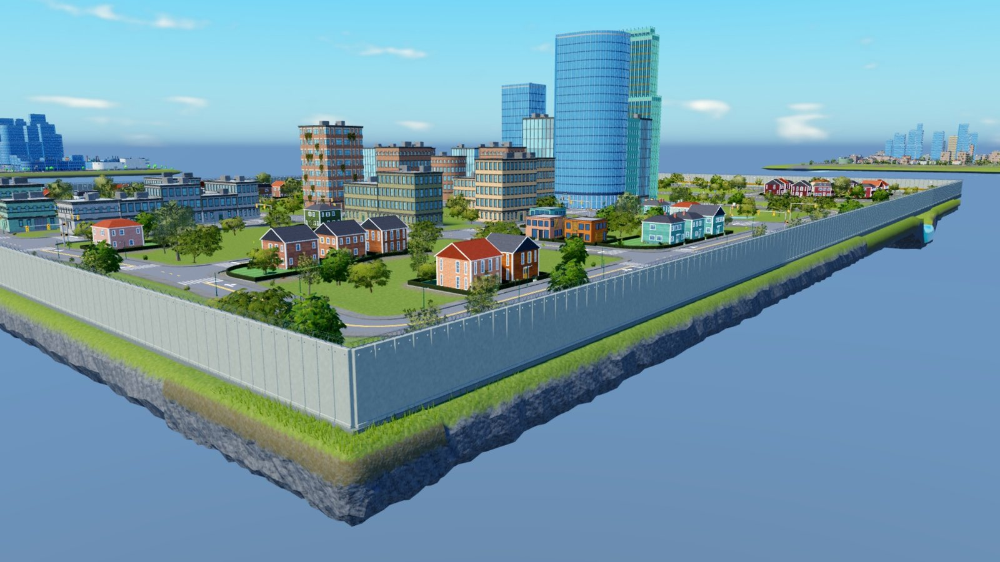
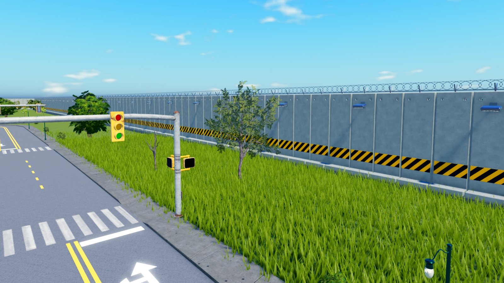
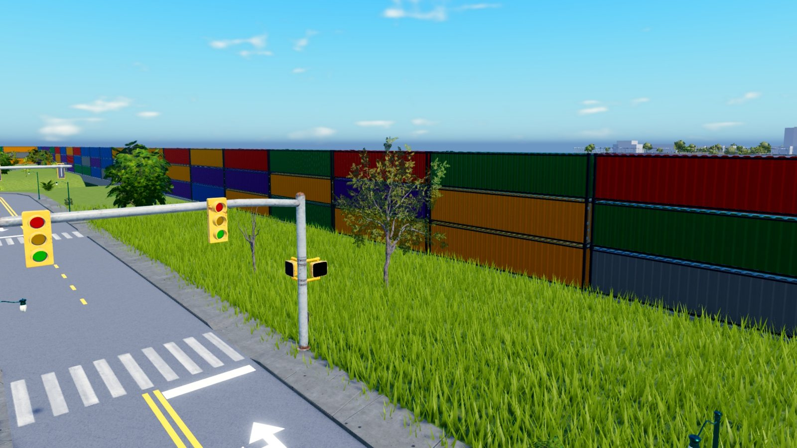

The build step is the same for a real place and a generated layout. Each heading below is a group in the dock.

## The estimate

Above the build button the dock shows an estimate: how many buildings and parts the city will have, and how long it takes to build. When the numbers are large it marks the build as a **Big build** and lists ways to lighten it:

- **Facade** or **Graybox** buildings
- **Mesh** roads, which use far fewer parts
- a smaller rectangle, fewer blocks, or a lower **Max count**

## Terrain

| Setting | Options |
| --- | --- |
| **Ground** | The same three kinds as the road tools' [ground](../roads/ground.md). **Terrain (carve and fill)** paints voxel terrain over the whole area, with water where the map or the layout has it. **Part ground** lays one plate under a flat city, or blocks and wedges under hills, and digs no water. It builds faster and moves with the city. **On the surface (baseplate)** lays no ground at all: the city stands flat at its build height and whatever is already there shows between the lots. It is the fastest build. |
| **Land** | **Flat**, **Hills** from noise, or **Real**, which reads the place's real elevation. Real needs Terrain ground and a real place. On the surface is always flat. |
| **Hill height**, **Hill spacing** | How far the hills rise and about how far apart they are. |
| **Exaggerate** | Multiplies real elevation differences. 1 keeps the map's scale. |

A generated layout has **Land shape** here instead. See [generated layouts](./generated-layout.md#land-shape).

## Buildings

**Build as** chooses what stands on the lots.

| Option | Result | Use it for |
| --- | --- | --- |
| **Bundle** | Detailed buildings and yards from the bundle. | Streets players walk. |
| **Facade** | Simple shapes that follow outlines, with repeating windows that look flat close up. | Skylines and background blocks. |
| **Graybox** | Plain blocks. The quickest build. | Blocking out a map and test builds. |

<video src={require("../img/change-buildings.mp4").default} poster={require("../img/change-buildings-poster.jpg").default} autoPlay loop muted playsInline controls style={{ width: "100%", borderRadius: 8 }} />

| Bundle | Facade | Graybox |
| :-: | :-: | :-: |
|  |  |  |

*One layout built three ways. The roads, lots and seeds are the same in all three.*

In every mode the [bundle](./bundles.md) still picks building types, plants, street furniture and lot bases.

| Setting | What it does |
| --- | --- |
| **Bundle** | The bundle the city is made from. |
| **Color style** | **Realistic** is light stone, concrete, gray, charcoal and muted blue. **Cartoony** is brighter pastel walls and colorful glass. |
| **Mapped colors** | On, Graybox blocks and Facade walls take the color the map gives each building. A generated layout has none. |
| **Rooftop units** | On, flat roofs get AC units, vents and stair huts. Turn it off for a game where nobody sees the roofs. |
| **Polygon buildings** | On, buildings stand on the map's real outlines where they clear roads and neighbors. Off, outlines round to rectangles. |
| **Max count** | Lots past this many, counted out from the middle, stay empty. |
| **Max stories** | Caps building height. Kit models keep their own height. |
| **Game stops** | On, ten stop buildings stand near the middle of the city: two gas stations, two garages, a car wash, a paint shop, a police station, a pharmacy, a hardware store and a supermarket. See [using a city in your game](../game-integration.md#game-stops). |

*A gas station from **Game stops**, with its driveways cut into the curb.*

### Change buildings

After a build, change one of these settings and **Change buildings** appears at the end of the group. It applies the new setting on the same lots and seeds as one undo step. A graybox city turns into a detailed one this way, and back.

## Roads

**Style** sets the materials of the city's streets, and **Build with** picks parts or meshes. After a build, **Change roads** applies a new style to the city.

Roads built as meshes have to be uploaded before the place is saved. See [mesh roads](../roads/drawing.md#mesh-roads).

## Props

| Setting | What it does |
| --- | --- |
| **Parked cars** | On, cars stand in the curbside parking bays, picked from the bundle's list. Turn it off for a game with its own traffic. |
| **Courtyard props** | On, apartment blocks get waste containers behind the sidewalk and transformer kiosks in their courtyards. |

**Change props** lays the plants and props again on a finished city.

## Walls

**Wall round the city** stands a wall along the edge of the city's ground, so nothing drives or walks off it.

| Setting | What it does |
| --- | --- |
| **Look** | **Bundle** lays the bundle's wall. The others are concrete, chain-link fence, shipping containers and quarantine wall. **Invisible** stops cars and people and shows nothing. |
| **Height** | How high the wall stands over the highest ground under it. |
| **Thickness** | For the concrete and invisible walls. A thin wall lets a fast car through, so keep it to a stud or more. |
| **Inset** | How far in from the edge of the ground the wall stands. The outermost streets end 32 studs from that edge. |
| **Skirt** | How far the wall reaches below the lowest ground under it, so nothing slips under. |
| **Preview walls** | Shows the wall in the world as you set it. The preview is never saved. |

**Lay walls** lays the wall on a city already built, and **Remove walls** takes it away.

| Quarantine wall | Shipping containers |
| :-: | :-: |
|  |  |

## Optional details

Tick the details you want and **Generate city** lays them. Tick more after a build and **Add details** lays them on that city.

- **Door paths.** A path from every building's door to its street. Paint on terrain, paving slabs on part ground.
- **Ground.** Grass variation, sandy shores and mapped ground materials. Terrain only.
- **Footpaths.** Paths that connect streets across open blocks. Plants and props along the new paths are cleared.

Ground and footpaths take longer on large areas.

## Build

**Generate city** builds the city. Once a city exists the button splits in two.

- **Regenerate** replaces the selected stages of the city you are editing, as one undo step.
- **Generate new** builds a second city and leaves the first one standing.

The **Debug** group picks the stages: ground, roads, buildings, and plants and props. With a stage unticked, Regenerate keeps what the city already has for it. **Road warnings** adds red markers where a road is missing or disconnected.
