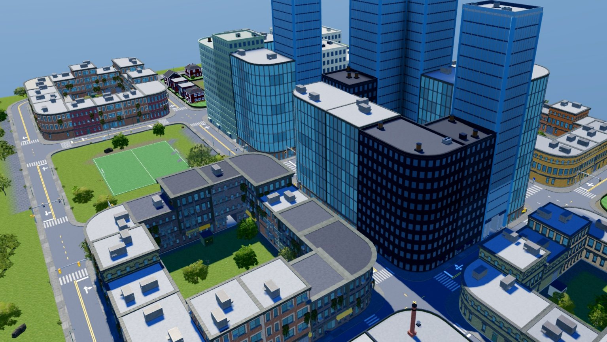
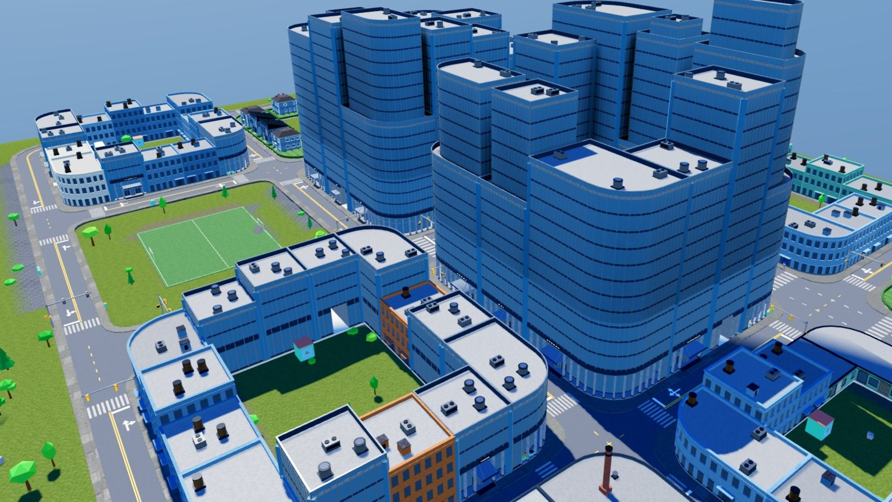
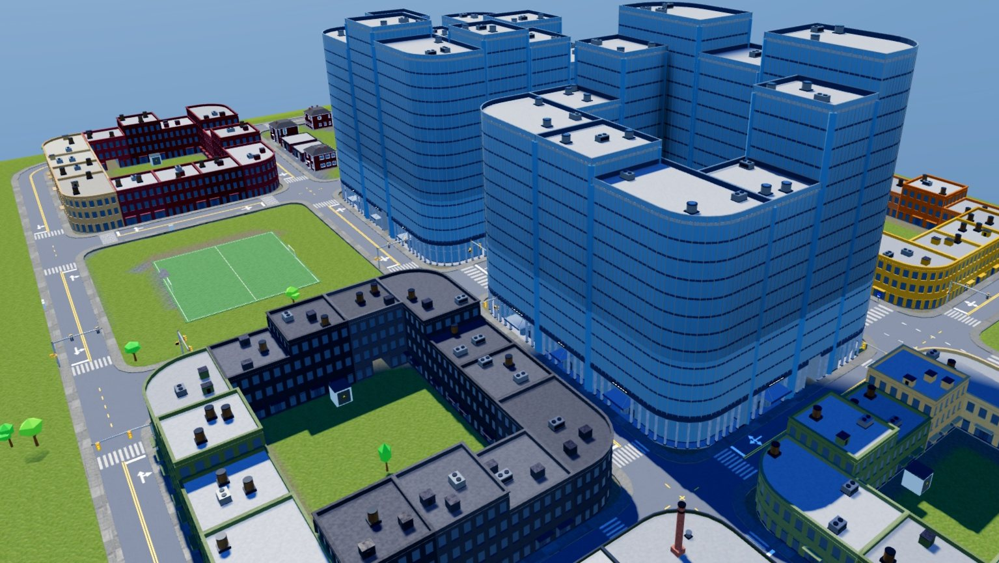

A bundle is the kit a city is built from. It holds:

- the buildings for each zone at each density, with their odds
- trees, bushes and rocks, and how thickly they grow
- street lamps and road items
- the road style and the terrain materials
- the lot base, and the city wall

## Built-in bundles

| Bundle | Look |
| --- | --- |
| **Realistic** | Houses, blocks and towers with kit facades, service buildings, forest trees, gardens around the houses, graded lots. |
| **Cartoony** | Part-built buildings in bright themes, low-poly gardens, round trees, plinths. |
| **Low detail** | Plain part-built buildings, sparse trees, no gardens or street furniture. |

| Realistic | Cartoony | Low detail |
| :-: | :-: | :-: |
|  |  |  |

*One layout and one seed in each built-in bundle.*

## Make your own

The built-in bundles cannot be changed. In the **Bundles** section, press **Duplicate** on one and edit the copy. The copy is saved in the place under `ServerStorage.CityBuilderBundles`.

### Buildings

Buildings are sorted by **Zone** and **Density**. Each one has odds and a **Max count**.

- **Add the plugin's own** adds a catalog building or one of your styles.
- **Add building** copies the model you have selected in Studio into the bundle.

A zone with nothing in it borrows from the next density, then from the next zone.

### Plants and props

**Add plant** copies the selected model in as a tree, bush or rock. Sliders set how thickly each kind grows in parks, woods and yards. A kind set to **None** does not grow in the city.

Street furniture goes in slots, such as bench, trash can and electrical box. Each slot picks among its entries by their odds. A model you add stands with its pivot's LookVector as its front. Add an Attachment named Ground where it touches the ground.

Street lights, bus stops, traffic signals and road signs stand on the roads, so they are in the Road tab. The Roads tool takes its items from the same bundle.

**Sign pack** in the Road tab picks the faces of the plugin's road signs. **Automatic** uses the country of the place a city is built from, and European signs elsewhere. The Realistic bundle is Automatic. Cartoony and Low Detail use the **Simple** set. A generated city also puts a speed limit sign at the start of each long road where it meets a road of another type, showing that road's speed. A bundle with an empty speed limit slot gets none.

### Lot base

| Option | Result |
| --- | --- |
| **Grade** | The terrain under each lot is levelled and banked. |
| **Plinth** | A solid base under each building. **Plinth depth** is how far it reaches below the lowest ground beside it. **Plinth looks like the selected part** copies a part's look. |
| **Straight on the ground** | Each building sinks into its uphill side. |

### Wall

In the Road tab, the wall is one of the plugin's own, or **Wall is** the model you have selected. The model is one segment, and the plugin lays it end to end around the city. A part that runs the model's whole length is stretched and joined around corners. Shorter parts, such as posts, repeat with each segment.

## Share a bundle

The **Share** section packs a bundle into a Folder you can copy into another place or publish as a model.
