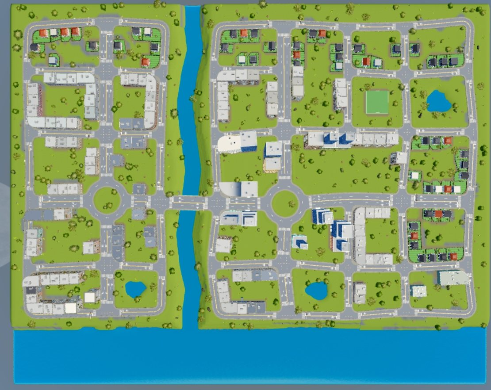
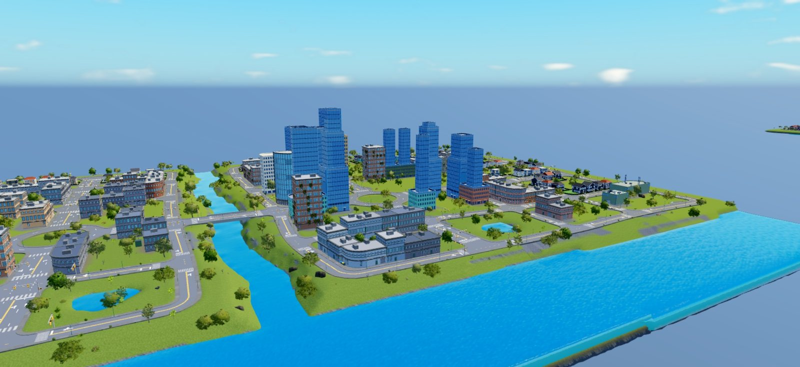

Set **Source** to **Generated** and the City Generator makes its own street layout. It needs no map server, and the same settings always give the same city.

The whole layout is one step, **Lay out city**. The map in the dock redraws on every change.

## Streets and districts

| Setting | Options |
| --- | --- |
| **Streets** | **Grid** is straight. **Organic** nudges the crossings and leaves a few side streets out. |
| **District** | **Whole city** runs from towers in the middle through mid-rise blocks to houses at the rim, with factories in one corner. **Downtown**, **Apartments**, **Suburb** and **Industrial** zone every block as one kind, which suits a few blocks added to a place. |

## Blocks

- **Blocks across** and **Blocks deep** set the size of the city. One block is a valid layout.
- **Block width** and **Block depth** set each block's street frontage in studs.
- **Avenue every** sets how often a street is a four-lane avenue, counted from the middle. 0 builds two-lane streets only.
- **Parks %** sets the share of blocks left as parks.

## Extras

| Setting | What it does |
| --- | --- |
| **River** | A river down a column of its own, green on both banks, bridged where an avenue crosses it. Needs at least three blocks across. |
| **Sea** | **Coast** lays the sea along the south side. **Square island** rings the city with sea. **Island** does too, in a shape the seed picks. |
| **Ponds in parks** | Most parks big enough get a pond in the middle. |
| **Ring road** | The streets around the edge of the city are four-lane avenues, so traffic can go around it. |
| **Old town** | The side streets around the middle blocks are walkways closed to traffic, and those blocks hold mid-rise shops and apartments instead of towers. |
| **Roundabouts where avenues cross** | Each crossing of two avenues becomes a two-lane roundabout. The four blocks around it lose their corner lots. |

Rivers and seas are dug as water on Terrain and Part ground. On the surface leaves a river as a green strip and the shore dry.

| From above | With a coast |
| :-: | :-: |
|  |  |

*An organic layout of 7 by 5 blocks with a river, a coast, ponds and roundabouts.*

## Land shape

With **Land** set to **Hills**, **Land shape** picks the hills.

| Shape | Result |
| --- | --- |
| **Rolling** | Hills anywhere, from noise. |
| **Valley** | A low middle with the ground rising toward the edges. |
| **Hilltop** | A crowned middle with the edges falling away. It suits an island. |
| **Hillside** | The whole city tilted one way. With a coast, it climbs away from the water. |
| **Ridge** | A spine across the city with slopes down both sides. |
| **Terraces** | Level shelves joined by short climbs. |

**Hill height** sets how far the shape rises.

## Seed

**Seed** fixes every random choice. **Shuffle** rolls a new one. Write the seed down to get the same city again in another place.

## How lots are cut

Each block is ringed with lots from junction to junction. The block's longer sides take the corners, and corner lots are rounded off where the curb is. Each corner's sidewalk is sized to the building on it, so the pavement runs right up to the wall.

After the layout, the build step is the same as for a real place. See [build settings](./build-settings.md).
