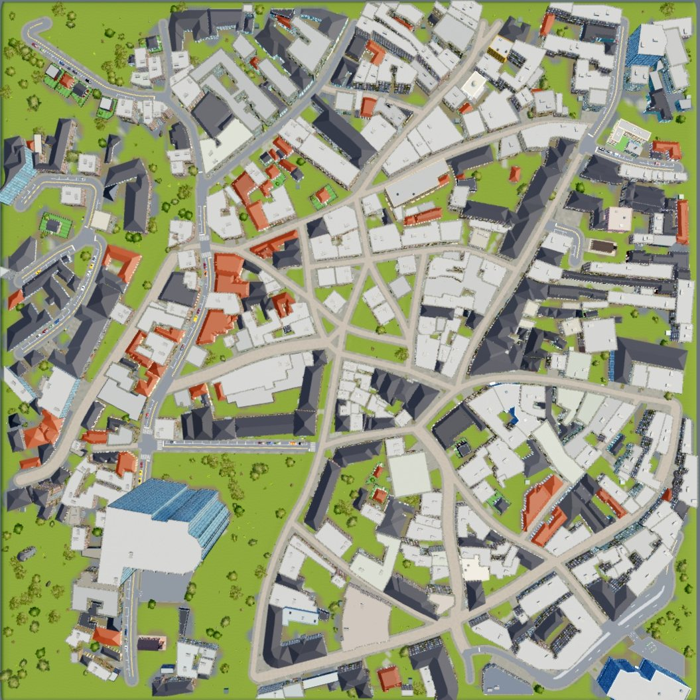

The City Generator builds a city in three steps: pick a place, pick an area, build. Set **Source** to **Real place** at the top of the dock.

<video src={require("../img/tallinn-orbit.mp4").default} poster={require("../img/tallinn-orbit-poster.jpg").default} autoPlay loop muted playsInline controls style={{ width: "100%", borderRadius: 8 }} />

*Tallinn's Old Town, 520 metres across, built from its map with the Realistic bundle.*

## Step 1: Select place

Find the place one of three ways.

- Type a name and press **Find**.
- Type a latitude and longitude.
- Find the spot on openstreetmap.org, center it there, and paste the page's URL. This is the quickest way to land on an exact block.

Six quick picks under the search skip the typing: Amsterdam, Tallinn, Paris, New York, Pärnu and Malé.

The dock draws a map of the place's main roads, water and parks.

## Step 2: Select area

Drag the rectangle over the part to build and resize it by its edges. Drag the map to look around, and double-click to send the rectangle there.

| Setting | What it does |
| --- | --- |
| **Aspect** | Holds the rectangle's width to depth while you drag. **Free** lets each side move alone. |
| **Size** | The rectangle's long side. |
| **Rotation** | Turns the rectangle on the map. The city is built with the rectangle square to the world, so streets along its sides come out along X and Z. |
| **Align to streets** | Finds the main street direction inside the rectangle and turns it to match. |
| **Round to** | The step the sides snap to: meters, studs, or off. |

Under **Position**, **Build at** is where the middle of the rectangle goes in the world, and **Set from camera** takes the ground under the middle of the view. **Show map on the ground** lays the map flat where the city will be built, at build size.

Press **Load detail**. The plugin fetches every street, building outline, land use and mapped tree inside the rectangle, and the map redraws with buildings colored by zone.

Start small, and read the estimate in Step 3 before you build. A city holds at most 4,000 road segments. Over that, the plugin keeps the main roads and the streets that branch off them.

## Step 3: Build

The build step's settings are covered in [build settings](./build-settings.md). The defaults give a detailed city on flat Terrain.

Press **Generate city**. The dock shows the stage it is on, the progress and the time left.

The generator works in this order.

1. Shapes the land: flat, hills, or the place's real elevation.
2. Lays the streets as the same road network the Roads tool draws.
3. Cuts lots, one per mapped building outline, then along streets where nothing is mapped.
4. Lays the ground and builds the roads.
5. Stands a building on each lot, sized to the lot and to the storeys the map gives.
6. Plants trees, fills parks and woods, and lines the streets with lamps.

*The same build from above. Streets, block shapes and building outlines come from the map.*

## Freeways

Mapped freeways keep each direction as its own road without sidewalks. Slip roads join their carriageway. Freeways pass other roads in open trenches or on bridge decks, and stacked freeway ways stay at separate heights through interchanges.

A freeway keeps its slope through bends and slip-road junctions. Sharp corners remain level.

## Scale

A city is built at 280 mm per stud, about 3.57 studs per metre. This matches the building kits and the drivable cars. A saved city keeps its own scale.

## What the city is

The city is a Folder, so nothing groups it into one object. Its buildings, plants and props are Models, filed in folders by map chunk. The whole city is one undo step.

What could not be built is counted on the city folder as attributes, such as `DroppedRoads` and `UnfilledLots`.
