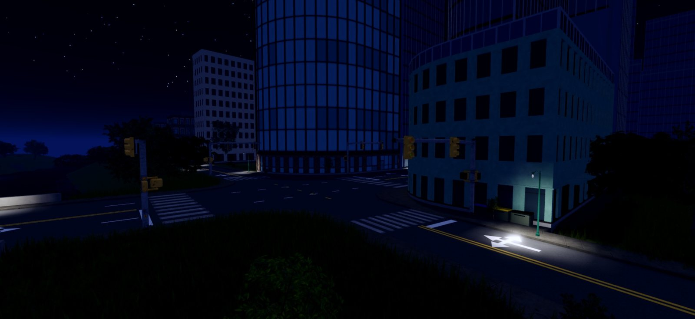
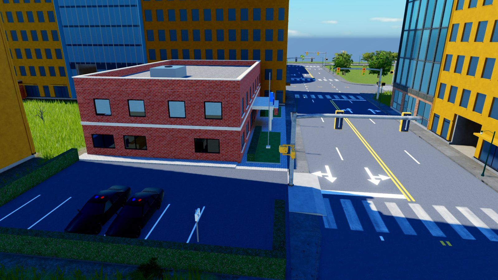

The plugin adds no scripts to your place. It marks what it builds with CollectionService tags and attributes, and your game reads them.

## Lights

Every light the plugin places starts with `Enabled = false`. The Light instances carry the `CityLight` tag, and street lamp models also carry `CityProp:Lamp`. Brightness, color and range are already set.

This turns on every placed light, including ones added later:

```lua
local CollectionService = game:GetService("CollectionService")

local function turnOn(light)
    if light:IsA("Light") and light:IsDescendantOf(workspace) then
        light.Enabled = true
    end
end

CollectionService:GetInstanceAddedSignal("CityLight"):Connect(turnOn)
for _, light in CollectionService:GetTagged("CityLight") do
    turnOn(light)
end
```

For a day and night cycle, call the same loop with `false` at sunrise.



*The Night lighting preset with every `CityLight` switched on.*

## Tags

| Tag | On | Notes |
| --- | --- | --- |
| `CityLight` | Every Light instance | Off by default. |
| `CityProp:Lamp` | Street lamp models | Other props carry `CityProp:` tags of their own kind. |
| `ParkingSpot` | An invisible box on every marked stall | Also `ParkingSpot:Public`, `ParkingSpot:Accessible`, `ParkingSpot:Police` or `ParkingSpot:Vacuum`. |
| `FlagSpot` | An invisible box on each flagpole | Hang your own flag there. |
| `CityWall` | Each run of the city wall | Also `CityWall:<Look>`. |

### Parking spots

The box's LookVector is the way a parked car faces. Its `ParkingSpotTaken` attribute says whether the plugin parked a car there.

### Flag spots

The box is the size of a flag. Its RightVector points out from the pole, and its `FlagColor` attribute holds a suggested color.

## Game stops

Game stops are plain Models in the city's `Stops` folder.

| Tag | On |
| --- | --- |
| `SpotFixture` | The stop's fixture, with a `SpotKind` attribute. |
| `SpotPrompt` | Each part that should take a prompt, with a `SpotActions` attribute. |
| `SpotBay` | A car service's invisible bay over the curb lane. |
| `CitySpot`, `CitySpot:<Kind>` | The building behind the stop. |

Doors on stop buildings are shut. Your game opens them.



*A police station stop. Its patrol bays are tagged `ParkingSpot:Police`.*

## Race tracks

| Tag | On | Attribute |
| --- | --- | --- |
| `RaceGridSlot` | Each invisible `GridSlot` part behind the start line | `GridPosition` |
| `RaceTimingGate` | The invisible `FinishLine` gate and each sector gate | `Checkpoint`. The start line is 0 and ends the lap. |

## Buildings at runtime

By default the code that bakes buildings stays in the plugin, so a published game holds only geometry. If your game resizes or re-bakes buildings while it runs, set **Generator code** to a copy in ServerStorage or ReplicatedStorage. See [generator code](./buildings/building-designer.md#generator-code).

## Where things are stored

| Location | Holds |
| --- | --- |
| `CityBuilderOutput` | The road network, the rail network and generated cities. |
| `ServerStorage.ProceduralSources` | The piece sets buildings are made from. |
| `ServerStorage.CityBuilderStyles` | Your building styles. |
| `ServerStorage.CityBuilderBundles` | Your bundles. |
| `MaterialService.CityBuilder` | Material variants the buildings use. |

## Drivable cars

**Spawn Car** on the toolbar puts every drivable car on the ground in front of the camera, each in a random color. Press Play and walk up to one to drive it.
