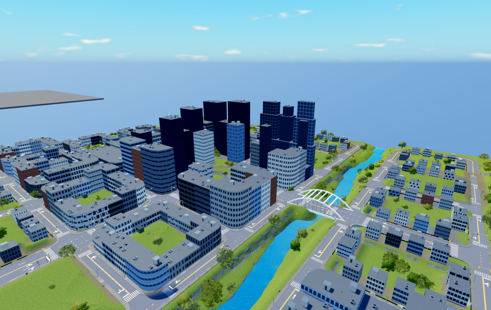

City Builder is a Roblox Studio plugin for making cities. You can draw one road at a time, place one building at a time, or generate a whole city from a real map and then keep editing it by hand.

## What is in it

The plugin adds one toolbar with these buttons.

| Button | What it opens |
| --- | --- |
| **City Builder** | The main dock. Its tool tiles are Roads, Rails, Buildings, Polygon building and Inspect. |
| **City Generator** | Builds a city from OpenStreetMap or from a layout made by a seed. |
| **Building Designer** | Turns a placed building into your own style: pieces, colors, materials, roof. |
| **Inspect Buildings** | Hover a placed building to see and change the piece in each cell. |
| **Lighting** | Lighting presets and one section per effect: sun, atmosphere, clouds, color grading. |
| **Spawn Car** | Puts every drivable car on the ground in front of the camera. Press Play and walk up to one to drive. |

## Where to start

- New to the plugin? Follow the [quick start](./quick-start.md). It draws a road, places a building and generates a small city.
- Building a road network by hand? Start with [drawing roads](./roads/drawing.md).
- Want a city in a few minutes? Go to the [City Generator](./city-generator/real-place.md).
- Making a game on top of a generated city? Read [using a city in your game](./game-integration.md) for the tags the plugin leaves on lights, parking spaces and props.

## How the plugin treats your place

A few rules hold everywhere in the plugin, and knowing them makes the rest of the docs shorter.

- Every edit is one undo step. A whole generated city is one undo step too.
- Everything the plugin builds goes under `CityBuilderOutput`. A place has one road network and one rail network, so any two roads can meet.
- Buildings are generated from settings, not stored as fixed meshes. Resize one with Studio's Scale tool and it lays itself out again at the new size.
- Lights the plugin places start switched off, so a city does not light itself in the editor. Your game turns them on. The snippet is in [using a city in your game](./game-integration.md#lights).
