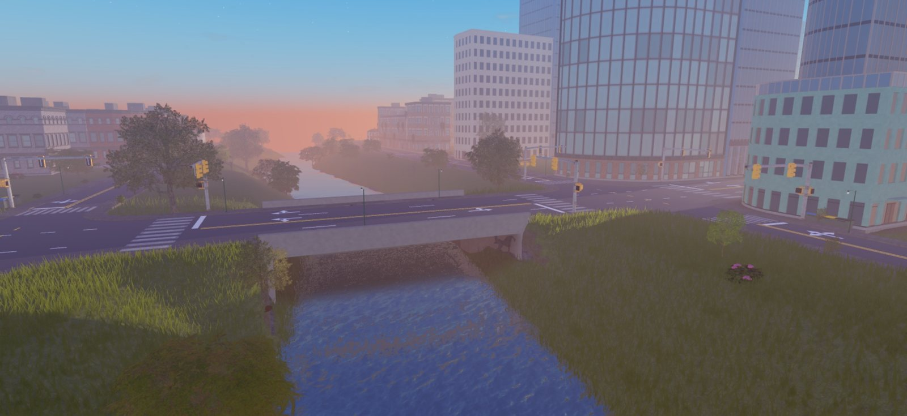
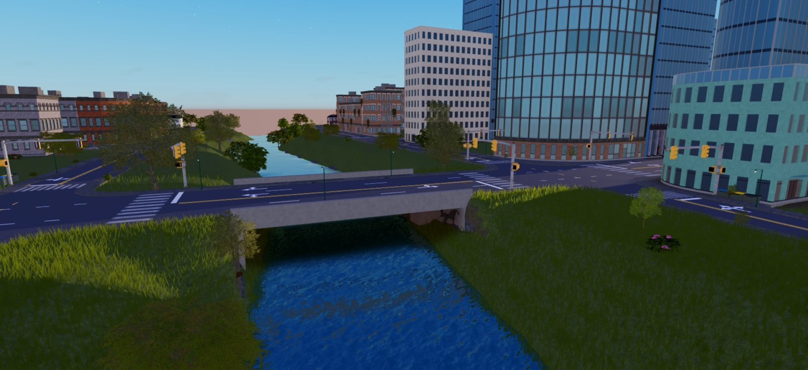
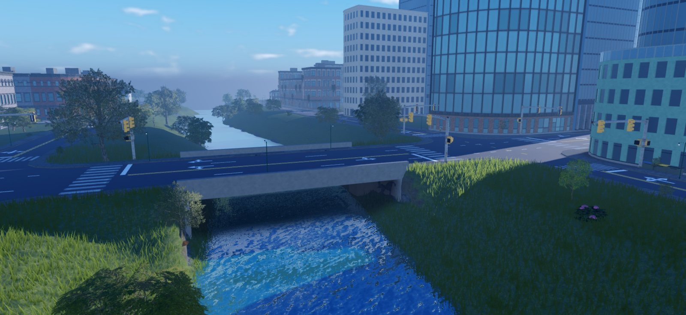
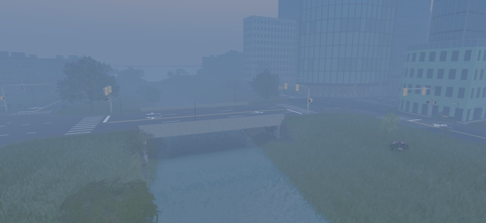
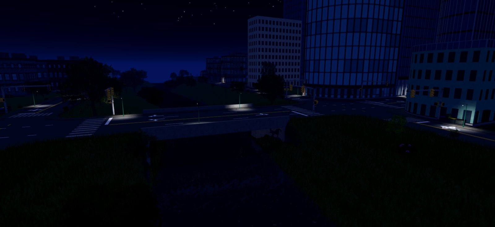

Press **Lighting** on the toolbar. The dock changes the place's Lighting service and its effects directly.

<video src={require("./img/lighting-presets.mp4").default} poster={require("./img/lighting-presets-poster.jpg").default} autoPlay loop muted playsInline controls style={{ width: "100%", borderRadius: 8 }} />

## Presets

A preset is laid over the lighting the place had when the dock opened.

- Postcard
- Zombie daylight
- The golden-hour family
- High noon
- Blue hour
- Night
- Overcast
- Misty morning
- Cinematic
- Miniature

| Golden hour | Golden clear | Cinematic |
| :-: | :-: | :-: |
|  |  |  |

| Overcast | Night |
| :-: | :-: |
|  |  |

*One view of a generated city under five of the presets.*

## Sections

Below the presets, each section drives one thing:

- time of day and latitude
- sun, moon and stars
- brightness, exposure, shadows and ambient colors
- atmosphere and clouds
- color grading, bloom, sun rays and blur
- depth of field
- the editor camera's field of view

A control writes only the effect it drives, and creates that effect if the place has none. Moving the clock never adds a Bloom.

## Undo and reset

Each change is in the place at once and is an undo step. A slider drag is one step, not one per frame.

**Reset** goes back to the lighting the dock opened on.
