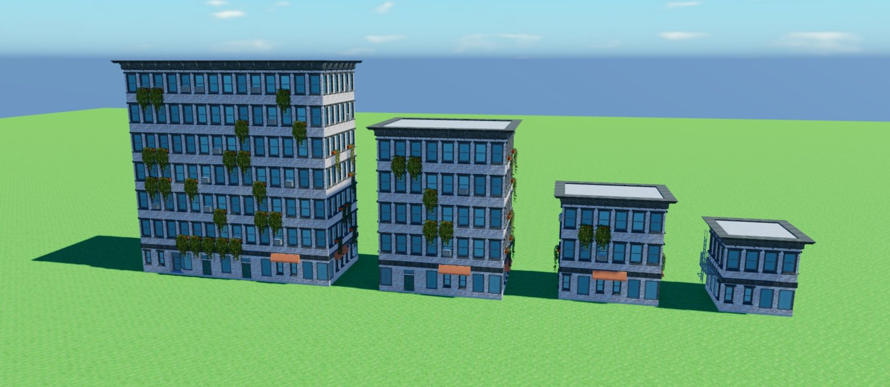
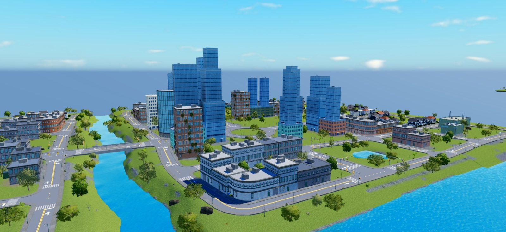

This page takes about five minutes. Start from an empty Baseplate place.

## 1. Draw a road

1. Press **City Builder** on the toolbar to open the main dock.
2. Pick the **Roads** tile. Under **Action**, pick **Draw**.
3. Under **Terrain**, set **Ground** to **On the surface (baseplate)**. The road will lie on the baseplate and reshape nothing.
4. Click on the baseplate to start the road. Click again to end a straight stretch.
5. Hold the mouse button and drag on the next click to bend that stretch into a curve.
6. Click on the side of the road you just drew. The new road meets it in a junction, with crosswalks and lane arrows.
7. Press **Esc** to end the chain. Press **Esc** again to stop the road builder.

A card in the corner of the viewport lists the keys the running tool answers to.

<video src={require("./img/draw-roads.mp4").default} poster={require("./img/draw-roads-poster.jpg").default} autoPlay loop muted playsInline controls style={{ width: "100%", borderRadius: 8 }} />

*Five roads drawn one after another. The junction, its crosswalks and its signals appear when the second road crosses the first.*

## 2. Place a building

1. Pick the **Buildings** tile.
2. Scroll the shelves and click a building. A ghost follows the mouse.
3. Click beside your road to place it. Each click places another one, in a new color.
4. Press **Stop placing**.
5. Select the building and drag a face with Studio's Scale tool. The building adds window bays and floors to fill the new size.

*One building at four sizes. Nothing is stretched: each size is laid out again from the same pieces.*

## 3. Generate a city

1. Press **City Generator** on the toolbar.
2. Set **Source** to **Generated**. This layout is made from a seed and needs no download.
3. Leave the defaults, or press **Shuffle** for another seed. The map in the dock redraws on every change.
4. Press **Generate city**. The dock shows progress and an estimate of the time left.

When the build ends you have streets, lots, buildings, trees and street lamps. Undo removes the whole city in one step.

## Next

- [Heights, bridges and tunnels](./roads/heights.md) for roads over hills and water.
- [Building from a real place](./city-generator/real-place.md) to build Tallinn or New York instead of a seed.
- [Building Designer](./buildings/building-designer.md) to make your own building styles.
