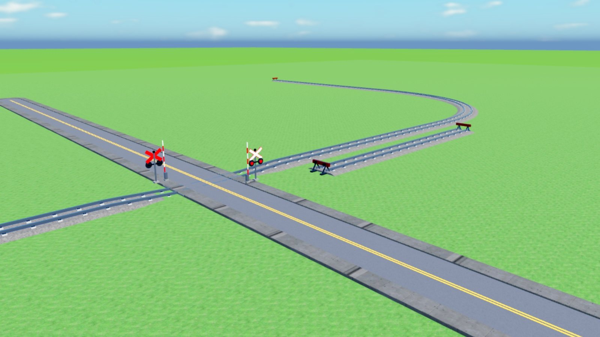
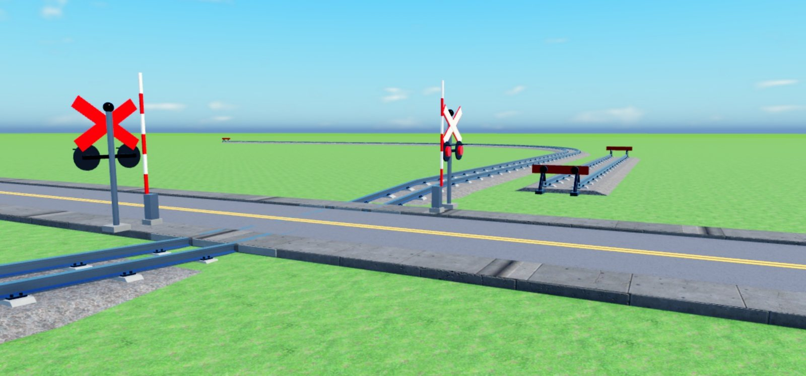

The **Rails** tile draws railways. The gestures are the ones the Roads tool uses.

## Draw a track

1. Pick the **Rails** tile and start the rail builder.
2. Click where the track starts.
3. Click the next end. Drag to bend the track.
4. Keep clicking to continue the chain. Press **Esc** to end it.

**Straight tracks** decides what a plain click lays: straight tracks when on, flowing curves when off. Press **C** to switch it. Hold still before releasing to reverse it for one track.

Ends snap to the ends of existing tracks. A track gets concrete sleepers, fasteners and ballast. An end that joins nothing gets a buffer stop. Where a track meets a surface road, the plugin lays crossing panels and a pair of crossing signals.

## Height

**Follow** uses the surface under the track. **Slope** grades between its ends. **Hold** keeps the start height. Ends that join another track keep that track's height.

**Level** is how many studs the track runs above or below the surface. **X** raises it by 48 studs and **Z** lowers it while drawing.

## Limits

- A bend needs a radius of at least 40 studs.
- A slope cannot be steeper than 8%.

## Edit and remove

**Edit** shows blue handles on track ends and orange handles on curves. Drag one to reshape the track. **Remove** deletes the track you click.

## What to know

- A place has one rail network, so any two tracks can meet. It is saved in the place under `CityBuilderOutput`, supports undo and redo, and can be edited after reopening the place.
- Ballast is built from parts and does not carve terrain.
- Railways that the City Generator lays from a map are separate from the tracks you draw here.
