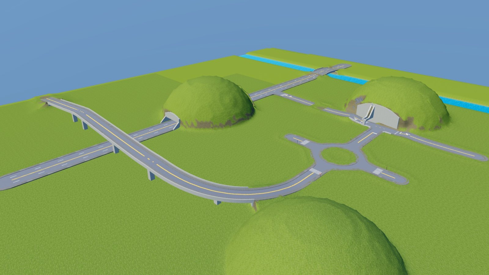

The **Roads** tile of the City Builder dock holds every road tool. **Action** picks the tool, and the card under it shows that tool's options.

| Action | What it does |
| --- | --- |
| **Draw** | Lays new roads. |
| **Junctions** | Lays a premade junction whole. See [junctions](./junctions.md). |
| **Edit** | Moves and bends roads and junctions, and sets widths and corners. See [editing roads](./editing.md). |
| **Upgrade** | Lays a road again as another road type. |
| **Roadside** | Changes one side of a road: edge, guardrail, lights, curb lane. See [roadside and road items](./roadside-and-items.md). |
| **Add items** | Puts crosswalks, bus stops, signs and driveways on a road. |
| **Remove** | Deletes the segment you click. |

## Draw a road

1. Pick **Draw**.
2. Click where the road starts.
3. Click where it ends for a straight road, or hold the button and drag to bend it into a curve.
4. Keep clicking to continue the chain. Each click ends one road and starts the next.
5. Press **Esc** to end the chain, and **Esc** again to stop the road builder.

<video src={require("../img/draw-roads.mp4").default} poster={require("../img/draw-roads-poster.jpg").default} autoPlay loop muted playsInline controls style={{ width: "100%", borderRadius: 8 }} />

**C** switches between straight and curved roads. While **Straight roads** is on, holding the button lays that one road curved, and the other way round.

## Join roads

Roads snap to the ends and sides of other roads. Start or end a road on another one and the plugin builds a junction there, with crosswalks, stop lines and lane arrows. The road types decide whether the junction gets traffic signals. You can change that afterwards with **Add items**.

Two roads drawn over each other merge into one. The plugin does not refuse an overlap.

## Road types

**Road** picks what you draw.

- Walkway
- 1 lane, 2 lanes, 3 lanes, 4 lanes, 6 lanes
- 2-lane side street
- 2-lane, 4-lane and 6-lane boulevards, which have a planted island down the middle
- Race track and Pit lane, covered in [race tracks](./race-tracks.md)

**One-way traffic** sets the direction of the lanes. Hold **Shift** while drawing to use the road type under the cursor, which is the fast way to carry on an existing street.

The City Generator lays a map's streets from this same list, so a road you draw into a generated city matches its streets.

## Change a road's type

Pick **Upgrade**, then pick the new type under **Road**. Point at a segment to preview it. Green means it gets wider and amber means narrower. Click to change it, or drag along a street to change every segment you cross as one undo step.

## Road style

Under **Road settings**, **Style** picks Realistic, Cartoony or Low detail. The style sets the materials and decides whether crosswalks, signals and island trees are drawn. The rows below it set the colors and materials of each part: road, sidewalks, curbs, islands and markings.

A style change is not built until you apply it. **Apply to all roads** builds every road again with the new settings at once.

## Mesh roads

**Build with** picks whether road surfaces are built from parts or as meshes. Meshes use far fewer parts, which matters in a large city.

A mesh made in Studio is lost if you save the place before uploading it. Turn on **Upload meshes automatically**, or press **Upload** before you save. The dock counts the meshes still waiting. If road pieces come back empty after reopening a place, press **Rebuild them**.

## Undo

Each road edit is one undo step. Removed pieces are kept out of sight until the undo history drops them, so Ctrl+Z brings a deleted road back exactly as it was.
