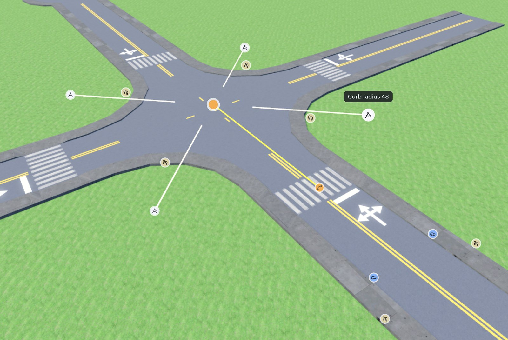

Pick **Edit** under **Action**. Roads drawn by hand and roads of a generated city edit the same way.

## Move and bend

- Drag a junction to move it. Every road that meets there follows.
- Drag the end of a road to move it. Drop it on another road to join them.
- Drag the middle of a road to bend it.

An edit rebuilds only the roads it touches. A large change takes longer but is never refused for its size.

## The dots

Point at a road and dots appear on it. Each dot sets one thing when you drag it.

| Dot | Color | Sets |
| --- | --- | --- |
| Car | Blue | The width of the carriageway. |
| Footprints | Sand | The width of the sidewalk. |
| Leaf | Green | The width of the island. Hold **Shift** to set it along the whole road. |
| Compass | White | The curb radius of a corner. |
| Tilt | Pink | The banking of a race track. Hold **Shift** to tilt the whole road. |
| Flag disc | Violet | How a dead end finishes. |

*The dots around a crossroads. The white compass dot under the mouse says what it sets, and the blue car dots sit across the road pointed at.*

Each corner of a junction has two dots. The compass dot rounds the curb. The footprints dot sets how wide the sidewalk is around that corner, so you can carry the pavement up to a building's corner. The sidewalk shows as it will be laid while you drag.

A corner radius that does not fit is not refused. The corner takes the nearest radius that does fit.

<video src={require("../img/edit-corners.mp4").default} poster={require("../img/edit-corners-poster.jpg").default} autoPlay loop muted playsInline controls style={{ width: "100%", borderRadius: 8 }} />

| Before | After |
| :-: | :-: |
|  |  |

*One crossroads before and after three edits. The corners got a wider curb radius, the far arm ends in a **Turning circle**, and the right arm ends **Open**.*

## Remove a road

Pick **Remove** and click a segment. On Terrain and part ground the plugin puts the ground back the way it was before the road.

## Rebuild all roads

**Rebuild all roads** lays every road in the place again from the saved network. Use it once after a plugin update that changes how roads are built, or when the changelog tells you to. Roads opened from an old save rebuild by themselves on the first edit.

## After reopening the place

The road network is saved in the place. Open the place later, start the road builder, and every road is editable again.
