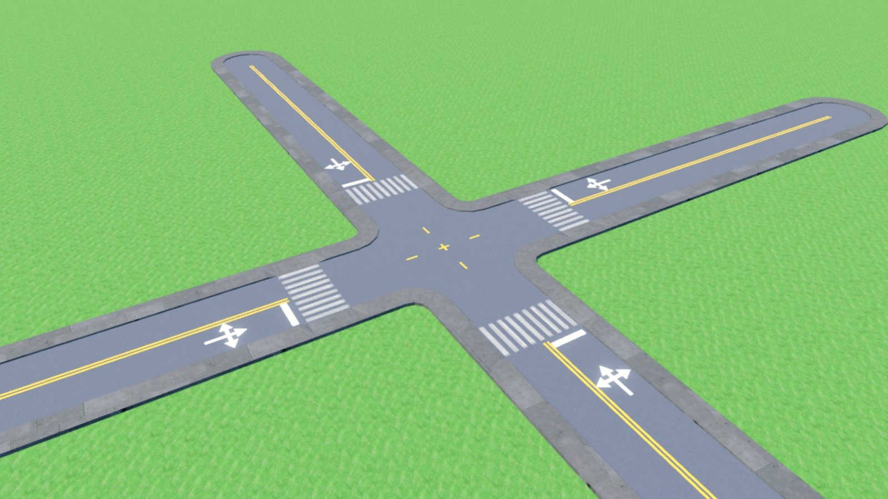
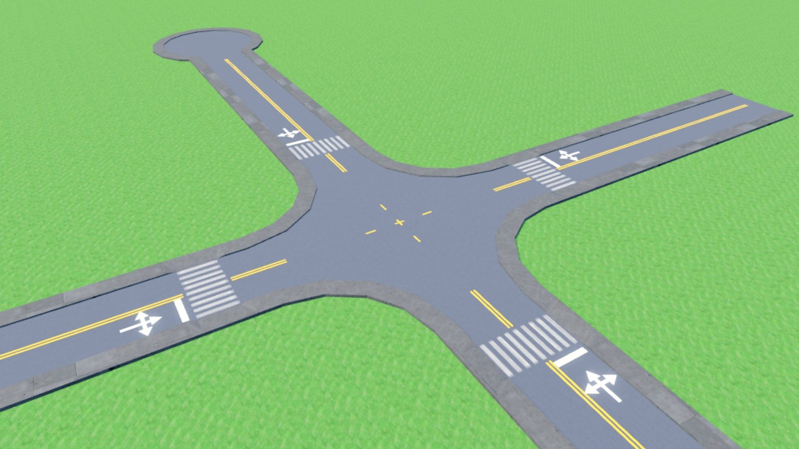

Pick **Edit** under **Action**. Roads drawn by hand and roads of a generated city edit the same way.

## Move and bend

- Drag a junction to move it. Every road that meets there follows.
- Drag the end of a road to move it. Drop it on another road to join them.
- Drag the middle of a road to bend it.

An edit rebuilds only the roads it touches. A large change takes longer but is never refused for its size.

## The dots

Point at a road and dots appear on it. Each dot sets one thing when you drag it.

| Dot | Color | Sets |
| --- | --- | --- |
| Car | Blue | The width of the carriageway. Its lanes share the width. |
| Footprints | Sand | The width of the sidewalk. |
| Leaf | Green | The width of the island. Hold **Shift** to set it along the whole road. |
| Compass | White | The curb radius of a corner. |
| Tilt | Pink | The banking of a race track. Hold **Shift** to tilt the whole road. |
| Arrows | Yellow | Where the center line stands, and so how many lanes run each way. |
| Chevrons | White | A painted gore between two lanes. Hold **Shift** to set it along the whole road. |
| Left-right arrows | Teal | Where the road meets a junction: centered, or with one curb lined up with the road across. |
| Flag disc | Violet | How a dead end finishes. |
| Walking figure disc | Violet | A junction's crosswalk. Drag it along the road to move the crosswalk, click it to turn it off or on, or to add a stop or yield line. See [Junction crosswalks and lines](#junction-crosswalks-and-lines). |
| Stop disc | Violet | A junction's stop or yield line. Drag it along the road to move the line, click it to change its kind or remove it. |
| Target disc | Violet | A junction's traffic light. Drag it to stand the light elsewhere near its corner, click it to take it out or put it back. |
| Plus disc | Violet | Adds an item to the road, or changes one side of it. See [Items on the road](#items-on-the-road). |
| Item disc | Violet | A bus stop, sign, driveway, street light, crosswalk or race line on the road. Drag it to move the item, click it for its settings. |
| Prop disc | Violet | A bench, trash can, fire hydrant, planter, mailbox, newspaper stand, utility pole or box, street tree or parked car beside the road. See [Street furniture](#street-furniture). |

*The dots around a crossroads. The white compass dot under the mouse says what it sets, and the blue car dots sit across the road pointed at.*

Each corner of a junction has two dots. The compass dot rounds the curb. The footprints dot sets how wide the sidewalk is around that corner, so you can carry the pavement up to a building's corner. The sidewalk shows as it will be laid while you drag.

A corner radius that does not fit is not refused. The corner takes the nearest radius that does fit.

<video src={require("../img/edit-corners.mp4").default} poster={require("../img/edit-corners-poster.jpg").default} autoPlay loop muted playsInline controls style={{ width: "100%", borderRadius: 8 }} />

| Before | After |
| :-: | :-: |
|  |  |

*One crossroads before and after three edits. The corners got a wider curb radius, the far arm ends in a **Turning circle**, and the right arm ends **Open**.*

### Hide some dots

A busy junction or a short road can carry so many dots that they cover each other and the one you want is hard to click. Open **Visual indicators** at the bottom of Edit settings and switch off the kinds you are not using, such as the curve handles, the corner dots or the lane paths. Switch them back on when you need them. Each row shows the dot it hides. A hidden dot can't be clicked either, so a click there takes the road under it. With **Road points** hidden you can still drag a junction or an end. Your choice is kept between sessions.

## Items on the road

The road you point at shows three plus discs: one on its center line and one on each sidewalk.

Click a sidewalk's plus to add a bus stop, a sign, a driveway, a street light or street furniture there. Most open a list to pick from: the bus stop's kind, the sign, the driveway's width, or the piece of furniture. The same card changes that side along the whole road: its edge, guardrail, street lights, curb lane and race items.

Click the center plus to add a crosswalk, a race start line or a sector line across the road. Its rows for the edge, guardrail, lights and curb lane change both sides at once.

Once an item is in place, the plus moves along to the next free spot, so a second click adds the next item beside the first rather than on top of it.

Every item on the road has its own violet disc with the item's icon:

- Drag the disc along the road to move the item. Drag it across the road to put a bus stop, sign or driveway on the other side.
- Click the disc to change the item, such as a shelter into a bus bay or one sign into another, or to remove it.

Rest the mouse on a row of either card to see what it would do before you click. The item gets a green outline and its model stands faint and green where it would go. Whatever the row takes away turns red, and a sidewalk or curb lane change draws the road's new surface. Rows for something that has no model, such as a crosswalk, show only the outline.

Crosswalks and race lines keep 40 studs from the road's ends, since the junction there lays its own crosswalks. Each add, move or change is one undo step.

A road's own street lights get item discs too. Drag one along the curb to move it, or click it and pick **Remove** to take that one light out. The rest of the side stays lit.

## Street furniture

Benches, trash cans, fire hydrants, planters, mailboxes, newspaper stands, utility poles and boxes, street trees and parked cars beside the road you point at each get a disc. These are the ones a generated city places, and any you add.

- Drag the disc to move the piece. It sits down on the ground where you let go and turns with the road, so a bench keeps facing the street, even if you drag it to the other side.
- Click the disc to turn the piece round, copy it a few studs along the road, or remove it.
- Add one from a sidewalk's plus: **Street furniture…** lists what the roads' bundle has.

Furniture keeps its place against the curb. Widen a road and the benches and hydrants on its sidewalks move out with the curbs; narrow it and they come in. Parked cars stay the same distance from the curb. Bend or move a road and its furniture goes along, and turns with it. This is part of the road edit's own undo step. Furniture beside a road you delete stays where it is.

**Regenerate** in the City Generator places the city's furniture afresh, so moves you made by hand are lost. Each move, copy or removal is one undo step.

## Junction crosswalks and lines

Each arm of a junction has a walking figure disc over its crosswalk, a stop disc over its stop or yield line, and a target disc over its traffic light where it has one.

Drag either disc along its road to move what it stands over. A crosswalk can't move further into the junction than the corners leave straight curb for its ramps, or past the middle of its road. A moved crosswalk takes its curb ramps and the stop line in front of it along. Click **Back to the junction's spot** on the disc's card to put it where the junction lays it.

Drag a traffic light's disc to stand the light anywhere within 40 studs of where the junction put it. Its card takes the light out or puts it back.

A junction paints the line its signs or signals ask for: a stop line at signals and stop signs, a yield line at yield signs, and none where nothing controls the arm. Click the stop disc to make the line a stop or a yield line whatever the control says, or to remove it. On an arm with no line, click the crosswalk's disc and pick **Add stop line** or **Add yield line** to paint one in front of the crosswalk. You can then drag it like any other line.

## Lanes each way

A two-way road of three lanes or more has a yellow dot on its center line. Drag it across the road and the center line moves with it, from one lane line to the next, giving one way more lanes than the other. Drag it back to the middle to share the lanes evenly again. The junctions at the road's ends mark their lanes to match. One drag is one undo step.

Where two roads with different splits meet, the center line eases across over about 40 studs for each lane it moves.

## Gores between lanes

A road of two lanes or more has a white chevrons dot on each lane line. Drag one across its line to open a painted gore there: two solid lines with chevrons between them. The lanes keep their width, and the road widens by the gore, half on each side.

Once a road has a gore, its line shows a dot at each of five stations along the road. Drag each to taper the gore, such as opening it from nothing to 16 studs on the way into a junction, where one lane parts from the others. Hold **Shift** to set the gore's width along the whole road. Drag every station shut to take the gore away. A road has one gore.

The junction's arrows and lane wiring stay in the lanes either side of the gore. Inside the junction the gore carries on between the same two lanes, as far as they part or until they meet again. The car dot still sets the lanes' own width.

## Line up a curb through a junction

Where the focused road meets a junction of three roads or more, a teal dot with left-right arrows sits on it near the junction. Drag it across the road to move where the road meets the junction. It snaps to the middle, and to lining either curb up with the road across the junction. That lets a wider road, such as one with a gore, keep one curb straight into a narrower road while the extra width goes to the other side.

The road bends over from its drawn line to meet the junction off center, and the junction's lanes, lines and curbs follow. Roads you draw always meet a junction in the middle.

## Remove a road

Pick **Remove** and click a segment. On Terrain and part ground the plugin puts the ground back the way it was before the road.

## Rebuild all roads

**Rebuild all roads** lays every road in the place again from the saved network. Use it once after a plugin update that changes how roads are built, or when the changelog tells you to. Roads opened from an old save rebuild by themselves on the first edit.

## After reopening the place

The road network is saved in the place. Open the place later, start the road builder, and every road is editable again.
