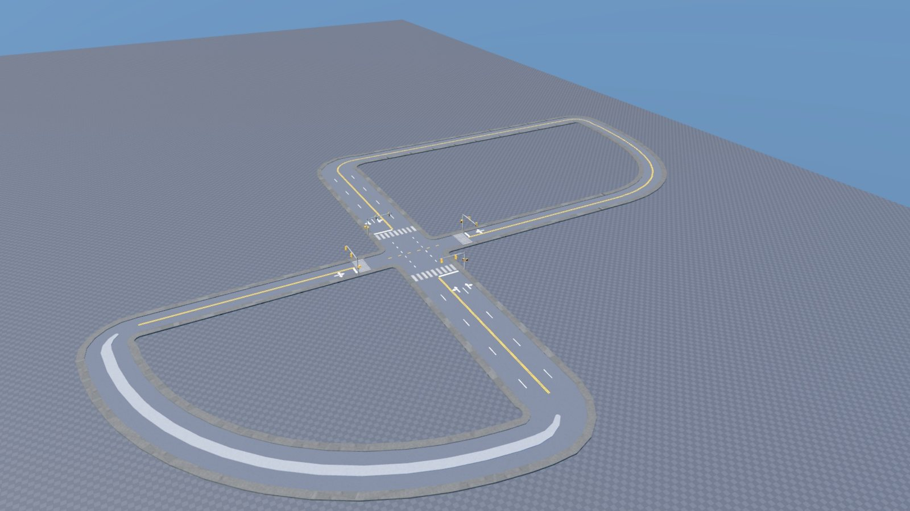

Roads need ground to lie on. The **Terrain** section of the Roads tool picks one of three kinds for the place's road network under **Ground**, before the first road. After that it shows the kind the roads were started on, so every tool that draws, edits or removes roads works on the same ground.

## Terrain

Roads cut and fill the place's Terrain. A road through a hill gets banks, lined cuts and tunnel bores, and a road across a dip gets fill under it.

Before the plugin first writes to a patch of terrain it saves what was there. Removing a road puts the hill back voxel for voxel.

Ground under paving is painted as Ground material instead of Grass, because terrain grass decoration grows through parts.

## Part ground

A square plate of parts that roads reshape the same way they reshape terrain. Set **Plate size** and **Hill height** in the dock.

The plate uses as few parts as it can. Flat ground is one part per 2048 studs, so a flat plate with level roads on it is a single part. Hills are triangles up to 64 studs across, split only where they would miss the graded ground or stand over a road. A road's banks are long strips beside it.

A road deep enough under a hill bores a tunnel, the same as on Terrain. The hill stays over the bore and steps up to it at each headwall.

A city built on Part ground digs its rivers, lakes and sea into the plate and fills them with blue, see-through water parts. You walk into the water rather than on it, down to the bed. Roads drawn across it later still bridge it. A plate made in the Roads tool has no water.

Use it when your game does not use Terrain, or when you want the low-poly look.

*Part ground with **Hill height** at 70. The brown parts are banks the roads cut.*

## On the surface

Roads lie on whatever is under them, such as a baseplate, and nothing is reshaped. This is the fastest kind and the right one for a flat map.

## Which to pick

| You want | Pick |
| --- | --- |
| Hills, cuts, tunnels and rivers you can swim in | Terrain |
| Hills, cuts, tunnels and water with no Terrain in the place | Part ground |
| A flat map, or the fastest edits | On the surface |

The City Generator has the same three choices under **Terrain > Ground** in its build step, and builds its roads on the ground it lays. Each city keeps its own ground: a road drawn into a Part ground city reshapes its plate, and a road drawn into a city built On the surface reshapes nothing.

## Keeping the ground up

Once roads are built, the Terrain section also holds the ground's upkeep. It is hidden when every road lies on the surface, since nothing is reshaped.

- **Shape ground for N road edits** shapes the ground that recent edits left.
- **Manual ground** makes road edits leave the ground alone until you shape it, which makes them much faster.
- **Shape ground across map** lays the ground again under every road. It is slow on a big map.
