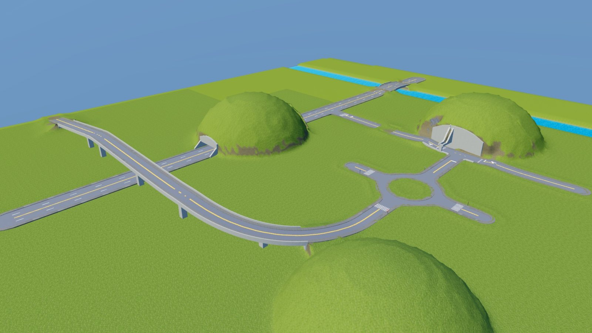
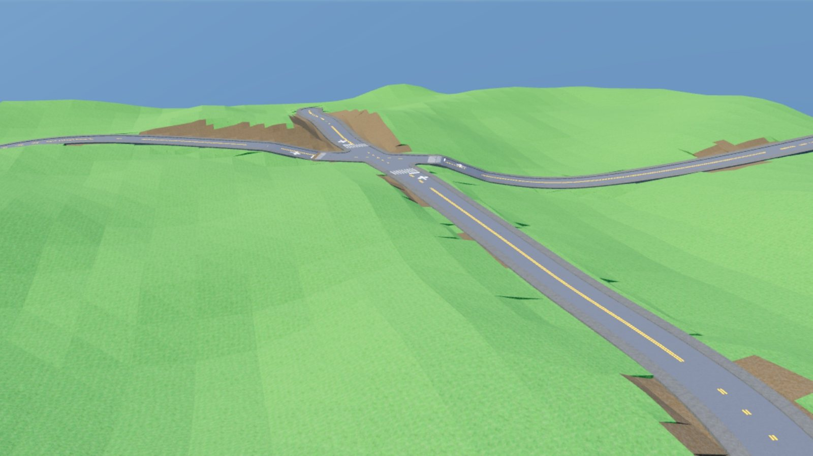

Roads need ground to lie on. **Ground** under Road settings picks one of three kinds for the place's road network.

## Terrain

Roads cut and fill the place's Terrain. A road through a hill gets banks, lined cuts and tunnel bores, and a road across a dip gets fill under it.

Before the plugin first writes to a patch of terrain it saves what was there. Removing a road puts the hill back voxel for voxel.

Ground under paving is painted as Ground material instead of Grass, because terrain grass decoration grows through parts.

## Part ground

A square plate of parts that roads reshape the same way they reshape terrain. Set **Plate size** and **Hill height** in the dock.

Flat ground merges into a few large parts. Hills are triangles 32 studs across, and the plugin splits a triangle further only where it would miss the graded ground or stand over a road. Part ground has no water.

Use it when your game does not use Terrain, or when you want the low-poly look.

*Part ground with **Hill height** at 70. The brown parts are banks the roads cut.*

## On the surface

Roads lie on whatever is under them, such as a baseplate, and nothing is reshaped. This is the fastest kind and the right one for a flat map.

## Which to pick

| You want | Pick |
| --- | --- |
| Hills, cuts, tunnels and rivers | Terrain |
| Hills with no Terrain in the place | Part ground |
| A flat map, or the fastest edits | On the surface |

The City Generator has the same choice under **Terrain > Ground** in its build step, and builds its roads on the ground it lays.
