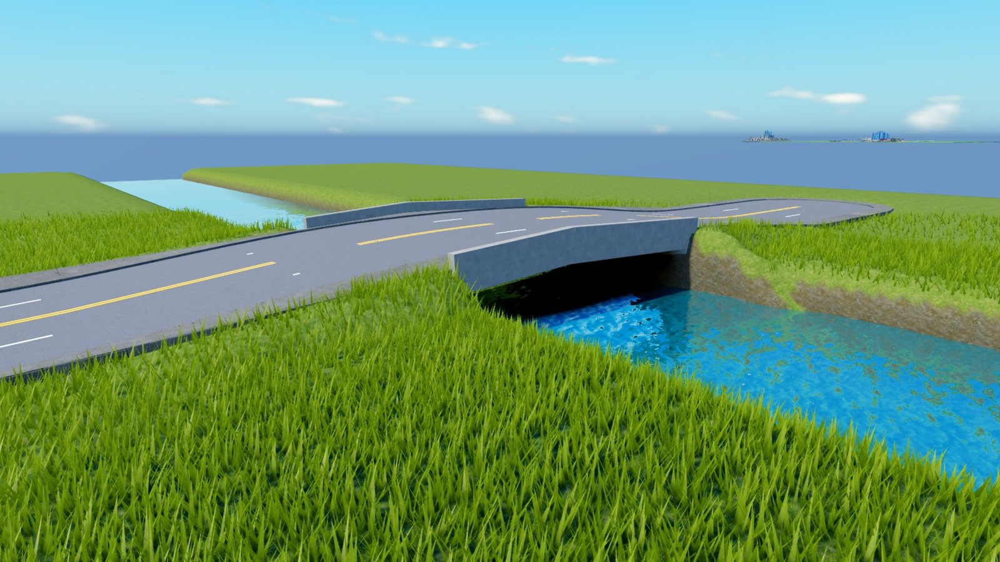
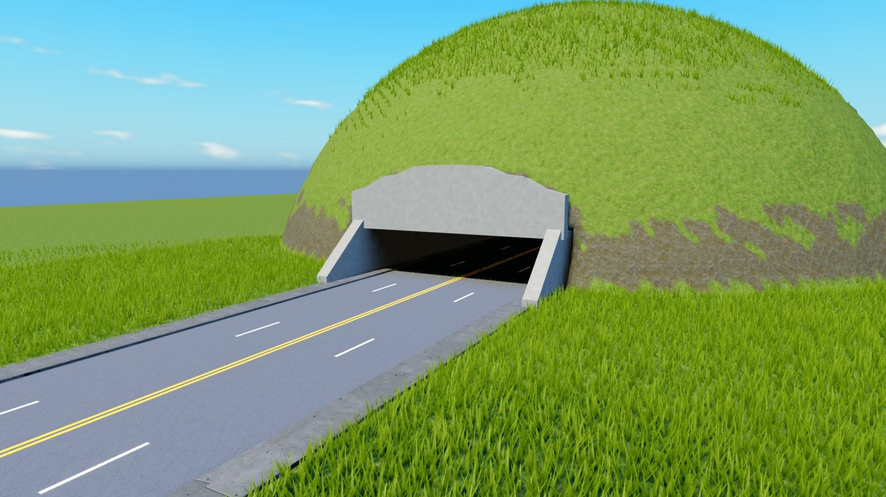
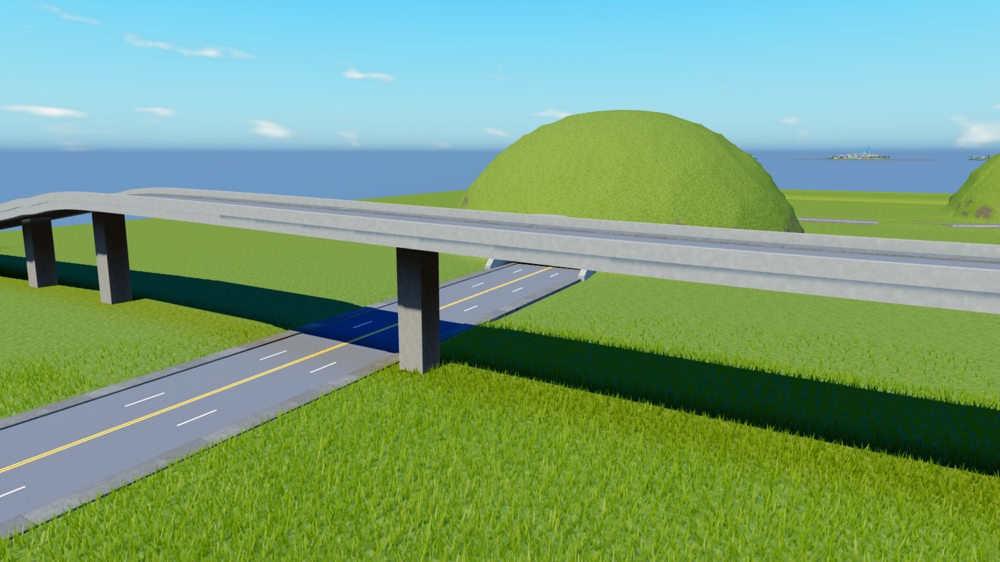

A road's height comes from the **Height** setting of the Draw tool. The plugin turns a road into a bridge or a tunnel on its own when it runs far enough above or below the ground.

## Height modes

| Mode | What the road does |
| --- | --- |
| **Follow** | Grades to the ground under it, cutting and filling where it has to. Use it for ordinary streets. |
| **Slope** | Climbs evenly to the ground where you click, plus the level. Use it for ramps. |
| **Hold** | Keeps the height the last road ended at, plus the level. Use it to carry a deck across a valley. |

**Level** is how far above or below the ground a Slope ends or a Hold runs, in whole road levels of 48 studs. One level is enough for a road to pass over another. Press **X** to raise it and **Z** to lower it while drawing. Both keys switch Height to Hold. Pick Slope again afterwards to climb to the new level instead.

**Hug ground** sets how much of the ground's rise and fall a Slope keeps between its ends. At 0 it climbs at one even grade, bridging dips and cutting through crests. At 100 it rides the hills like Follow.

Steep roads are allowed. The plugin warns about a steep grade and builds it anyway.

## Bridges

A road far enough above the ground stands on a deck with piers. You do not pick a bridge tool. Draw with **Hold** or **Slope** across a dip, or raise the road with **X**, and the deck appears where the ground falls away.

**Bridge** in the Draw options picks the bridge type for the road, and **Bridge color** its paint. **Guardrail** sets the railing a deck gets.

With **Bridge water** on, a road drawn across water climbs to a bridge deck and comes back down by itself. With it off, the road is refused until you raise it with Level.

## Tunnels

A road far enough below the ground bores a tunnel. On terrain the plugin cuts the bore, lines the walls and builds a portal that fits the hillside at each end. The quickest way to make one is to draw with **Hold** straight into a hill.

## Roads over roads

Two roads at different levels cross without making a junction. Draw the first road, press **X**, and draw the second across it. The upper road gets a deck over the lower one and returns to the ground past it.

For a full interchange with ramps, use a premade one from the [Junctions](./junctions.md) tool.

## Where the height is measured

Heights are the ground's drawn surface. Terrain draws its surface about 2 studs above the level its voxels are filled to, and the plugin accounts for that, so a road meets the grass beside it with no step.
