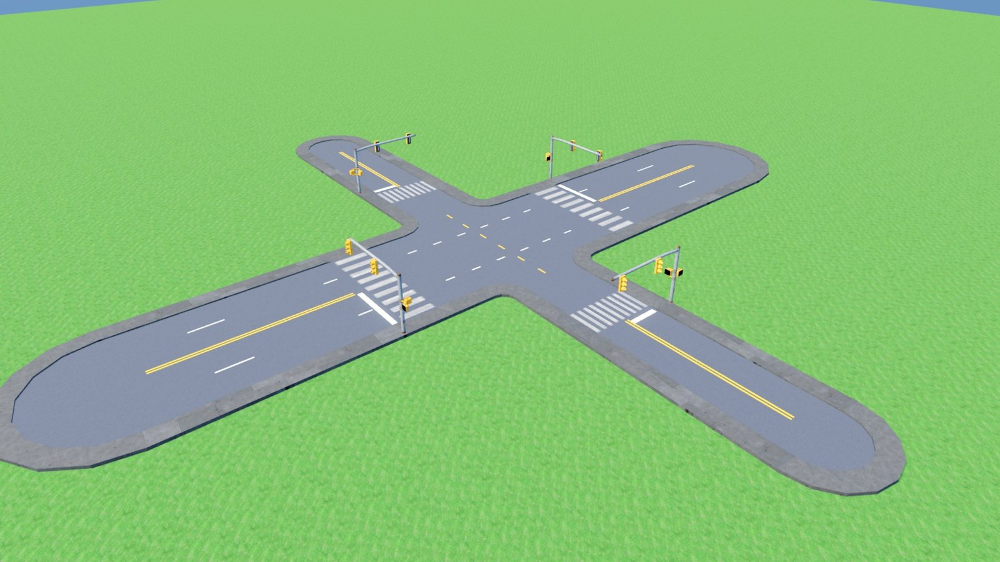
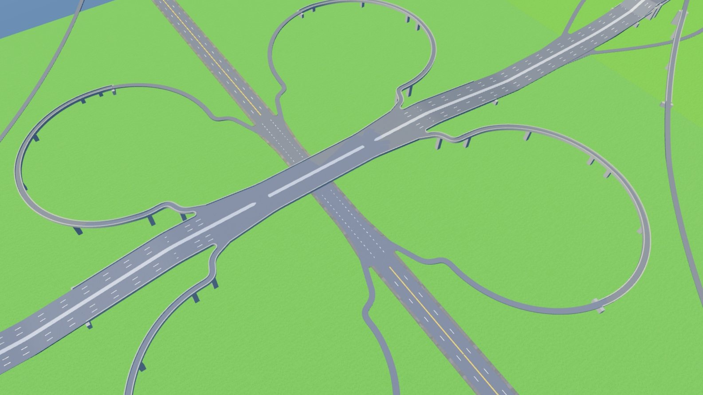

Any two roads that meet make a junction on their own. The **Junctions** tool is for the ones that take many roads to draw: roundabouts, gyratories and highway interchanges.

| Signalized crossroads | Single-lane roundabout |
| :-: | :-: |
|  |  |

| Diamond interchange | Roundabout interchange |
| :-: | :-: |
|  |  |

*A cloverleaf. One click lays all of it: the highway, the road it crosses, four loops and four outer ramps.*

## Lay a junction

1. Pick **Junctions** under **Action**.
2. Pick a junction from the list and change its settings.
3. Click to place it.

Where you point decides what happens.

- On open ground the junction is laid whole. **X** or **R** turns it 5 degrees forward, **Z** or **Shift+R** back.
- On an existing junction, that junction becomes the one you picked and its roads become the arms.
- On a road, the junction is laid across it.

What the tool lays is ordinary roads. Edit them afterwards like any other.

## What is in the list

**Junctions.** Signalized crossroads, boulevard crossroads, crossroads with slip lanes, jughandle crossroads, T junction with stop sign, Y junction, five-way star and staggered crossroads.

**Roundabouts.** Compact, single-lane, three-arm, five-arm skewed, with splitter islands, two-lane, two-lane with bypass lanes, three-lane, three lanes on the main flow, four-lane, signalized gyratory, star square with eight avenues, through-about and dogbone.

**Interchanges.** Overpass, diamond, cloverleaf, cloverleaf with loops only, trumpet and roundabout interchange.

## Change how a junction is controlled

Pick **Add items**, then the junction control item, and click a junction.

| Option | Result |
| --- | --- |
| **Automatic** | The road types decide. |
| **Traffic signals** | Lights on every arm. |
| **Stop signs**, **Yield signs** | Signs on the minor arms. |
| **Uncontrolled** | No lights, signs or stop lines. |
| **Roundabout** | A circle with an island and yield signs, if the approaches have room. |

## Corners and dead ends

Also under **Add items**:

- The corner item sets a junction's curbs. **Sweeping curve** is a wide bend that needs room. The other options set a fixed radius.
- The end item sets how a dead end finishes. **Rounded curb** closes it, **Open** cuts it flat so a later road can carry on from it, and **Turning circle** widens it into a cul-de-sac.
