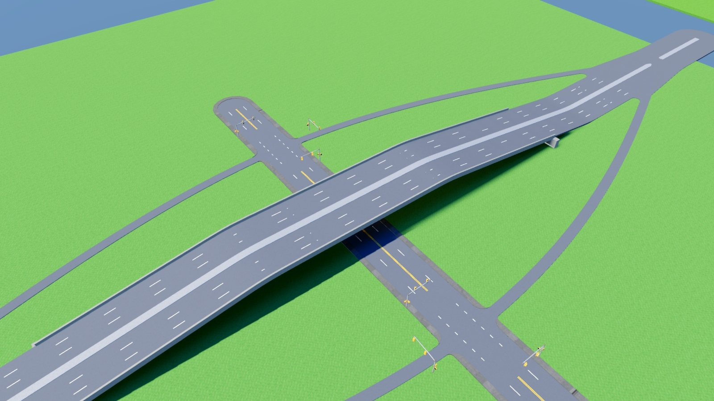

Any two roads that meet make a junction on their own. The **Junctions** tool is for the ones that take many roads to draw: roundabouts, gyratories and highway interchanges.

| Signalized crossroads | Single-lane roundabout |
| :-: | :-: |
|  |  |

| Diamond interchange | Roundabout interchange |
| :-: | :-: |
|  |  |

*A cloverleaf. One click lays all of it: the highway, the road it crosses, four loops and four outer ramps.*

## Lay a junction

1. Pick **Junctions** under **Action**.
2. Pick a junction from the list and change its settings.
3. Click to place it.

*The settings of a single-lane roundabout. Each junction in the list has its own rows.*

Where you point decides what happens.

- On open ground the junction is laid whole. **X** or **R** turns it 5 degrees forward, **Z** or **Shift+R** back.
- On an existing junction, that junction becomes the one you picked and its roads become the arms.
- On a road, the junction is laid across it.

What the tool lays is ordinary roads. Edit them afterwards like any other.

## What is in the list

**Junctions.** Signalized crossroads, boulevard crossroads, crossroads with slip lanes, jughandle crossroads, T junction with stop sign, Y junction, five-way star and staggered crossroads.

**Roundabouts.** Compact, single-lane, three-arm, five-arm skewed, with splitter islands, two-lane, two-lane with bypass lanes, three-lane, three lanes on the main flow, four-lane, signalized gyratory, star square with eight avenues, through-about and dogbone.

**Interchanges.** Overpass, diamond, cloverleaf, cloverleaf with loops only, trumpet and roundabout interchange.

## Change how a junction is controlled

Pick **Add items**, then the junction control item, and click a junction.

| Option | Result |
| --- | --- |
| **Automatic** | The road types decide. A narrower side street that meets a road running straight through gets a give-way sign. |
| **Traffic signals** | Lights on every arm. |
| **Stop signs**, **Yield signs** | Signs on the minor arms. |
| **Uncontrolled** | No lights, signs or stop lines. |
| **Roundabout** | A circle with an island and yield signs, if the approaches have room. |

## Lane markings

Every junction works out where each lane goes and marks its roads to match. Nothing needs setting.

- **Arrows** show what each lane may do. If the road ahead has fewer lanes, the spare lanes turn instead, right turns first.
- **Lines through the junction** continue the lane lines. Where a turn enters a wider road, lines fan out so the turn can take any free lane.
- **Hatched wedges** fill asphalt no lane uses, such as the nose between two roads that part at a shallow angle. Hatching stops where any lane's way crosses it, and a wedge ends once the lanes either side close up to it.
- **Hatched islands** fill the gap where two lanes side by side split up to let another lane in between, or close up again after one, as long as no lane beside the gap runs against them. An island is lined all round and starts with a blunt nose once the gap is 6 studs wide.
- **Solid lane lines** run up to the stop line, so drivers pick a lane before the junction.
- **Edge lines** carry on through the junction along the curb where a one-way road runs on into another, round the corner at the curb's own radius or straight across where the curbs line up.
- **A lane with nowhere to go** ends before the junction. Beside the curb it tapers away over hatching. Between a right-turn lane and the lanes going straight, it ends in a hatched wedge.

Junctions only side streets meet stay unmarked, and a road that runs straight past a narrower side street keeps its own lines.

To see and change the plan, keep **Show lane paths** on under the Draw or Edit settings. Near a junction, each way through it shows as a colored wire most of a lane wide, one color for each road it comes from. The wires stay up while the pointer is anywhere over the junction, and while you drag one, the rest stay in view:

- A **plus** disc sits where each lane enters the junction. Drag it onto a lane of another road to send the lane there as well.
- A **link** disc sits at the end of each wire, in the lane it lands in. Drag it onto another lane to send the way there instead. To take that way out, Shift+click the disc, or drop it away from every lane. A lane left with no way ends before the junction.

A road never gains a lane between two others on its own. If your wiring leaves a lane in the middle of a road with nothing feeding it, the lane feeding its neighbor and lined up most nearly with it fans out into it as well. Taking a way out with Shift+click or a drag is the exception: the lane it fed stays empty until you wire a lane into it again.

The junction's arrows, lines and hatching follow the wiring. Each change is one undo step.

A way that turns into the next road round follows the corner's curb at its lane's distance, so it never cuts across the curb. Where a corner is too tight for the turn, drag the white compass dot in that corner outward. A wider curb radius gives the junction room: the two roads beside that corner stand back as far as the curve needs, and the junction's other roads keep their ends. The dot goes up to a radius of 120, as far as the roads are long enough to hold the curve.

Where a junction's box is long, as where a side road bends in at a slant, its zebra crossings and stop lines move in along the straight curbs to stand by the corners, and the road's lines carry on up to them.

## Corners and dead ends

Also under **Add items**:

- The corner item sets a junction's curbs. **Sweeping curve** is a wide bend that needs room. The other options set a fixed radius.
- The end item sets how a dead end finishes. **Rounded curb** closes it, **Open** cuts it flat so a later road can carry on from it, and **Turning circle** widens it into a cul-de-sac.
