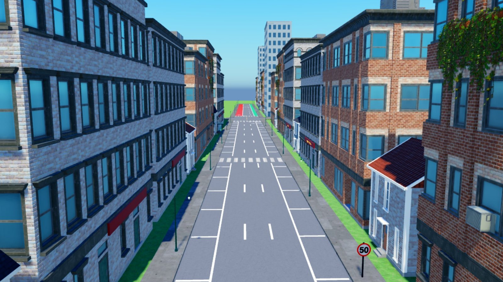
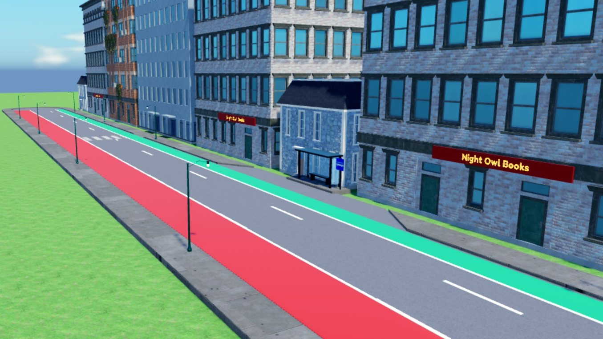
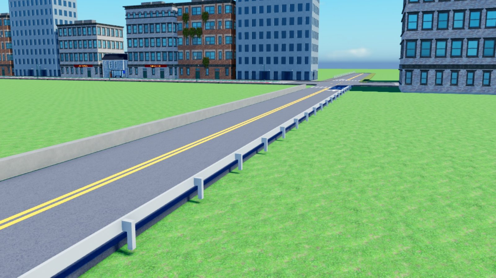

Two tools dress a road after it is drawn. **Roadside** changes a whole side of a road. **Add items** puts single things on it.

*Parking bays and lights from **Roadside**. The crosswalk and the sign are from **Add items**.*

## Roadside

A side of a road has four things you can set: its **Edge**, a **Guardrail**, **Lights**, and the **Curb lane** beside the curb. Race tracks add [race items](./race-tracks.md#race-items). In each row, **None** lays nothing.

The tool has two modes.

- **Select.** Click a side of a road to pick it, or drag along it to pick a stretch. What that stretch holds shows in the dock, and you change it there. Hold **Shift** to add to the pick.
- **Paint.** Set the rows first, then click every side that should get them.

| Curb lanes | Guardrails |
| :-: | :-: |
|  |  |

*Left, a **Bus lane** and a **Bike lane**. Right, a **Concrete barrier** and a **Steel guardrail** on a road with no sidewalk.*

Guardrails, walls and curb paint close up around bends. Each piece runs on until its outside corner meets the next one's, so no wedge of ground shows between them.

## Add items

Pick **Add items**, pick the item, and click the road. Clicking a placed item removes it.

| Item | Where to click | Result |
| --- | --- | --- |
| Crosswalk | A road between junctions | A zebra across it, with dropped curbs. |
| Bus stop | The side of a road | **Sign only**, **Shelter**, or **Bay with shelter**, which cuts a pocket into the sidewalk. |
| Sign | The side of a road | A sign on the sidewalk, facing the traffic on that side. |
| Driveway | The curb in front of a building or parking lot | A dropped curb with asphalt across the sidewalk. |

The left picture above has a bus stop with **Bay with shelter**. The curb steps back into the sidewalk to make the pocket.

Crosswalks that a junction laid by itself can be removed the same way. A removed one stays outlined in gray, and a click puts it back.

Junction control, corners and dead ends are also under **Add items**. They are covered in [junctions](./junctions.md#change-how-a-junction-is-controlled).

## Street lights

Lights placed along a road start switched off and carry the `CityLight` tag. See [using a city in your game](../game-integration.md#lights) for the code that turns them on.
