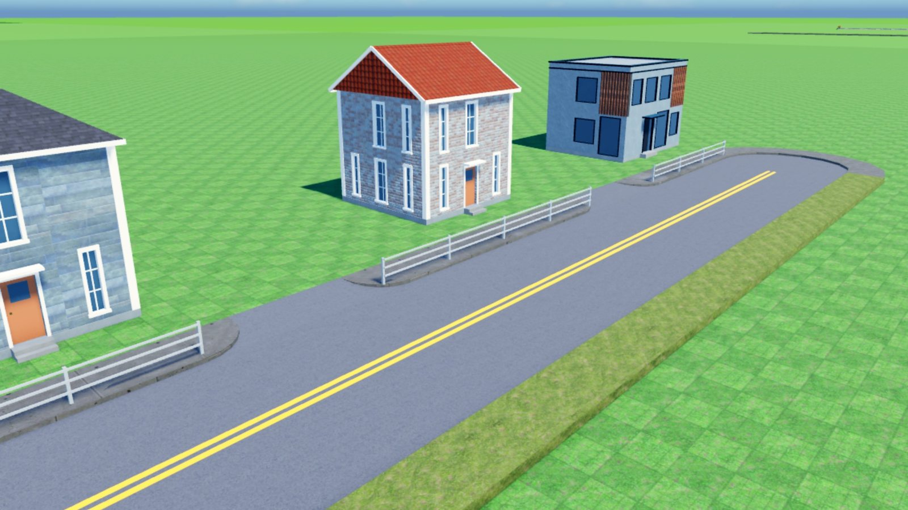

Two tools dress a road after it is drawn. **Roadside** changes a whole side of a road. **Details** puts single things on it.

*Parking bays and lights from **Roadside**. The crosswalk and the sign are from **Details**.*

## Roadside

A side of a road has four things you can set: its **Edge**, a **Guardrail**, **Lights**, and the **Curb lane** beside the curb. Race tracks add [race items](./race-tracks.md#race-items). In each row, **None** lays nothing.

The tool has two modes.

- **Select.** Click a side of a road to pick it, or drag along it to pick a stretch. What that stretch holds shows in the dock, and you change it there. Hold **Shift** to add to the pick.
- **Paint.** Pick what to set under **Change**, pick its value in the row below, then click every side that should get it.

| Curb lanes | Guardrails |
| :-: | :-: |
|  |  |

*Left, a **Bus lane** and a **Bike lane**. Right, a **Concrete barrier** and a **Steel guardrail** on a road with no sidewalk.*

Guardrails, walls and curb paint close up around bends. Each piece runs on until its outside corner meets the next one's, so no wedge of ground shows between them.

## Details

Pick **Details**, pick the item's button, and click the road. Clicking a placed item removes it. The **Remove** button removes any of them: it outlines the placed item nearest the cursor in red, whatever its kind.

| Item | Where to click | Result |
| --- | --- | --- |
| Crosswalk | A road between junctions | A zebra across it, with dropped curbs. One that would reach into a junction is refused. |
| Bus stop | The side of a road | **Sign only**, **Shelter**, or **Bay with shelter**, which cuts a pocket into the sidewalk. |
| Sign | The side of a road | A sign on the sidewalk, facing the traffic on that side. |
| Driveway | The curb in front of a building or parking lot | A dropped curb with asphalt across the sidewalk. |

The left picture above has a bus stop with **Bay with shelter**. The curb steps back into the sidewalk to make the pocket.

*Two driveways. Each drops the curb and opens the fence. The far side of the street has a **Grass verge** instead of a sidewalk.*

Crosswalks that a junction laid by itself can be removed the same way. A removed one stays outlined in gray, and a click puts it back.

Junction control is under **Junctions**, and corners and dead ends are changed with **Edit**. Both are covered in [junctions](./junctions.md#change-how-a-junction-is-controlled). The race start and sector lines are covered in [race tracks](./race-tracks.md#start-line-and-sectors).

## Road signs

**Sign** lists about 60 kinds: stop and yield, bans, mandatory turns, warnings, and service signs such as parking, bus stop and gas station. **Speed limit (by road type)** shows the speed for the road the sign stands beside. It is 30 km/h on a side street, 50 on a 2- or 3-lane street, 70 on a 4-lane road and 110 on a 6-lane road, or the nearest value the country posts. **Speed limit 20** to **Speed limit 130** pick a value. A country without that value shows its nearest one.

What a sign looks like comes from the bundle's **Sign pack**, set in the bundle's Road tab. There are 17 country and region packs and a **Simple** set for cartoony cities. A city the City Generator builds from a real place takes the pack of that place's country when the pack is **Automatic**. Drawn roads use the European signs. Some countries have no sign of a kind. The UK has no priority road, for example. A sign of that kind shows the European one, so a sign you place always appears.

A bundle model in a sign slot keeps its own look. Packs only change the plugin's own signs.

## Street lights

Lights placed along a road start switched off and carry the `CityLight` tag. See [using a city in your game](../game-integration.md#lights) for the code that turns them on.
